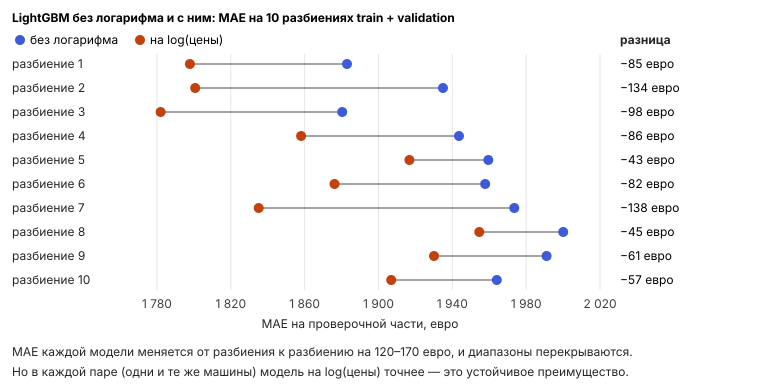

## Зачем это нужно

За модуль мы перебрали десятки вариантов — кодирование категорий, силу штрафа, число деревьев — и по validation выбрали лучший: LightGBM на логарифме цены, 1 842 евро. Прежде чем записать итоговое число в отчёт, ответим на три вопроса:

1. Не повезло ли с разбиением — устойчиво ли преимущество модели?
2. Что скрывает одно число MAE — как ошибки распределены по машинам?
3. Какой будет ошибка на новых машинах — то есть на test?

## Разброс метрики по разбиениям

В уроке 6.7 мы уже проверяли выбор на пяти разбиениях. Теперь сделаем это аккуратнее и сравним два близких варианта: LightGBM на ценах и на логарифме цены. Объединённые train и validation (`X_temp`) делим заново десять раз, test не трогаем. Обе модели учатся и проверяются на **одних и тех же** частях. Чтобы цикл шёл быстрее, деревьев по 100. Он займёт около 10 секунд:

```python
rows = []
for seed in range(10):
    Xa, Xb, ya, yb = train_test_split(X_temp, y_temp, test_size=0.25, random_state=seed)
    Ca, Cb = as_category(Xa, Xa), as_category(Xb, Xa)
    p_price = lgbm(100).fit(Ca, ya).predict(Cb)
    p_log = np.exp(lgbm(100).fit(Ca, np.log(ya)).predict(Cb))
    rows.append({'MAE, цена': mean_absolute_error(yb, p_price), 'MAE, log': mean_absolute_error(yb, p_log),
                 'RMSE, цена': root_mean_squared_error(yb, p_price), 'RMSE, log': root_mean_squared_error(yb, p_log)})
runs = pd.DataFrame(rows)
print(runs.round(0))
```



MAE модели на ценах меняется от 1 880 до 2 000 евро, на логарифме — от 1 782 до 1 955. Диапазоны перекрываются. Модель на логарифме на неудачном разбиении ошибается сильнее, чем модель на ценах на удачном. Сравнивать модели, проверенные на разных разбиениях, бессмысленно. Сравнивают **пары** — на одних и тех же машинах:

```python
diff = runs['MAE, цена'] - runs['MAE, log']
print(f'По MAE log лучше в {(diff > 0).sum()} из {len(diff)} разбиений, разница от {diff.min():.0f} до {diff.max():.0f} евро')
diff_rmse = runs['RMSE, цена'] - runs['RMSE, log']
print(f'По RMSE log лучше в {(diff_rmse > 0).sum()} из {len(diff_rmse)} разбиений')
fig, axes = plt.subplots(1, 2, figsize=(10, 3))
runs[['MAE, цена', 'MAE, log']].plot.box(ax=axes[0], vert=False)
runs[['RMSE, цена', 'RMSE, log']].plot.box(ax=axes[1], vert=False)
axes[0].set(xlabel='евро', title='MAE на 10 разбиениях')
axes[1].set(xlabel='евро', title='RMSE на 10 разбиениях')
fig.tight_layout()
plt.show()
```

По MAE логарифм выигрывает во всех 10 разбиениях, на 43–138 евро. Если увеличить число разбиений до 50, он выиграет во всех пятидесяти. Это устойчивое преимущество. С RMSE картина другая: сама метрика скачет от 3 743 до 7 536 евро, а логарифм выигрывает лишь в 3 разбиениях из 10. RMSE решают несколько машин с огромными ошибками — попали они в проверочную часть или нет. Поэтому выводы о моделях делают по метрике, выбранной заранее (у нас MAE). Разницу, которая на повторных разбиениях то положительная, то отрицательная, считают шумом.

## Ошибки по машинам

MAE — одно число на 6 414 машин. Посмотрим на сами ошибки: обучим на train лучшую модель и, для сравнения, Ridge на логарифме цены из урока 7.6.

```python
C_train, C_valid = as_category(X_train, X_train), as_category(X_valid, X_train)
best = lgbm().fit(C_train, np.log(y_train))
best_pred = pd.Series(np.exp(best.predict(C_valid)), index=y_valid.index)
ridge = Pipeline([('enc', ColumnTransformer([('cat', OneHotEncoder(handle_unknown='ignore'), cat_cols),
                                             ('num', StandardScaler(), num_cols)])),
                  ('model', Ridge(alpha=0.3))]).fit(X_train, np.log(y_train))
errors = pd.DataFrame({'Ridge на log': (y_valid - np.exp(ridge.predict(X_valid))).abs(),
                       'LightGBM на log': (y_valid - best_pred).abs()})
print(errors.quantile([0.5, 0.75, 0.9, 0.99]).round(0))
worst_share = errors['LightGBM на log'].nlargest(len(errors) // 100).sum() / errors['LightGBM на log'].sum()
print(f'1 % худших машин дают {worst_share:.0%} всей ошибки LightGBM')
ax = errors.plot.box(vert=False, showfliers=False, figsize=(8, 2.6))
ax.set(xlabel='Модуль ошибки, евро', title='Ошибки по машинам validation (без выбросов)')
plt.show()
```

У LightGBM половина машин оценена точнее чем на 876 евро, три четверти — точнее чем на 1 876. Но у 1 % машин ошибка больше 16 000 евро, и эти 64 машины дают 16 % всей суммы ошибок. Боксплоты показывают, что LightGBM лучше Ridge по всему распределению, а не только «в среднем»: и медиана, и квартили у него меньше. Выбросы на графике скрыты (`showfliers=False`), иначе бокс сжался бы в точку. Кто они, эти худшие машины?

```python
worst = errors['LightGBM на log'].nlargest(6).index
print(X_valid.loc[worst, ['Make', 'Model', 'Year', 'Distance']]
      .assign(Price=y_valid[worst], прогноз=best_pred[worst].round(0)))
```

Первая — «прочая» модель 2009 года за 120 000 евро, и цена совпадает с пробегом: похоже, при вводе перепутали поля. Дальше Volkswagen Passat 2015 года и Honda CR-V 2013 года за 100 000 евро, BMW 2001 года с пробегом 404 500 км за те же 100 000. Это почти наверняка ошибки ввода: лишний ноль или цена в другой валюте. Модель оценила эти машины разумно, а «ошибку» создала цена. Mercedes G Class 2021 года за 151 450 евро — реальная дорогая машина, и модель недооценила её на 62 000: таких машин в train единицы. Подобные записи стоит найти и разобрать до обучения (модуль 2). Пока они есть, они раздувают MAE и ещё сильнее — RMSE.

## Распределение остатков

**Остаток** — разница между ответом и прогнозом в той шкале, в которой модель училась, здесь — в логарифмах. Q–Q-график (урок 4.6) сравнивает квантили остатков с квантилями нормального распределения:

```python
res = np.log(y_valid) - best.predict(C_valid)      # остатки в шкале обучения
fig, ax = plt.subplots(figsize=(5, 4))
stats.probplot(res, dist='norm', plot=ax)
ax.set(title='Q–Q: остатки LightGBM (log цены)', xlabel='Квантили нормального распределения',
       ylabel='Квантили остатков')
plt.show()
z = (res - res.mean()) / res.std()
print(f'Остатков дальше 3σ: {np.mean(np.abs(z) > 3):.1%} (у нормального распределения — 0,3 %)')
```

Середина ложится на прямую, а хвосты уходят от неё. Дальше 3σ лежат 2 % остатков — в семь раз больше, чем у нормального распределения. Правый хвост длиннее: это машины, цена которых намного выше прогноза, те самые «100 000 евро». Для практики это значит: правило «ошибка почти всегда в пределах ±2σ» здесь не работает. Описывать точность лучше квантилями ошибок — «у половины машин меньше 900 евро, у 90 % — меньше 3 800».

## Итоговая проверка на test

Модель выбрана, гиперпараметры зафиксированы. Как в уроке 6.7, обучаем её на train и validation вместе и **один раз** проверяем на test:

```python
C_temp, C_test = as_category(X_temp, X_temp), as_category(X_test, X_temp)
final = lgbm().fit(C_temp, np.log(y_temp))
test_pred = np.exp(final.predict(C_test))
test_err = np.abs(y_test - test_pred)
print(f'Test: MAE = {mean_absolute_error(y_test, test_pred):.0f}, RMSE = {root_mean_squared_error(y_test, test_pred):.0f}')
print(f'Медиана ошибки: {test_err.median():.0f}, 90-й процентиль: {test_err.quantile(0.9):.0f}')
```

MAE на test — 1 840 евро, почти как на validation (1 842). RMSE — 5 482 против 4 444 на validation: в test попали свои машины с огромными ошибками. Итог для отчёта: «модель ошибается в среднем на 1 840 евро. У половины машин ошибка меньше 890 евро, у 90 % — меньше 3 800». После этого модель не меняем: любая правка «по итогам test» превращает test в ещё одну validation.

## Типичные ошибки

:::mistake Сравнивать модели, проверенные на разных разбиениях
MAE каждой модели гуляет на 100–170 евро от разбиения к разбиению. Сравнивают на одних и тех же частях и смотрят на разность.
:::

:::mistake Верить разнице в десятки евро на одном разбиении
Прежде чем выбирать, проверьте на повторных разбиениях или кросс-валидацией. Разница, которая меняет знак, — шум.
:::

:::mistake Выбирать модель по RMSE, когда в данных есть ошибочные цены
RMSE решают несколько огромных ошибок: метрика скачет вдвое и меняет победителя. Метрику выбирают заранее, исходя из задачи.
:::

:::mistake Описывать точность только средним
За MAE 1 840 стоят типичная ошибка меньше 900 евро и редкие промахи на десятки тысяч. Квантили ошибок и боксплот рассказывают больше.
:::

## Мини-квиз

```quiz
- q: MAE модели A на 10 разбиениях — от 1 880 до 2 000, модели B — от 1 782 до 1 955. Что нужно, чтобы решить, какая лучше?
  options:
    - Сравнить их на одних и тех же разбиениях и посмотреть, в скольких B лучше
    - Сравнить средние MAE — этого достаточно
    - Ничего — диапазоны перекрываются, значит, модели одинаковы
  answer: 0
  explain: "Перекрытие диапазонов ничего не говорит: в каждой паре B может быть лучше. Здесь — во всех 10."
- q: Почему RMSE на разных разбиениях менялась от 3 700 до 7 500, а MAE — лишь на 120–170 евро?
  options:
    - RMSE возводит ошибки в квадрат, и её определяют несколько машин с огромными ошибками
    - RMSE считается по меньшему числу машин
    - Это ошибка в расчёте
  answer: 0
  explain: Попали машины за «100 000 евро» в проверочную часть или нет — от этого RMSE меняется вдвое.
- q: 1 % машин даёт 16 % всей ошибки. Что это значит для отчёта?
  options:
    - Одного среднего мало — нужны квантили ошибок и разбор худших машин
    - Модель плохая
    - Эти машины нужно удалить из test
  answer: 0
  explain: Типичная ошибка меньше средней. Худшие машины часто оказываются ошибками в данных — их разбирают, а не прячут.
- q: На Q–Q-графике остатков середина на прямой, а хвосты уходят вверх и вниз. Что это означает?
  options:
    - Крупные ошибки случаются заметно чаще, чем у нормального распределения
    - Остатки распределены нормально
    - Модель недообучена
  answer: 0
  explain: Тяжёлые хвосты — 2 % остатков дальше 3σ против 0,3 % у нормального.
```

## Что запомнить

- MAE зависит от разбиения: здесь на 120–170 евро. Модели сравнивают на одних и тех же разбиениях и смотрят на разности. Устойчивое преимущество — когда разность почти всегда одного знака.
- RMSE гораздо шумнее MAE, если в данных есть огромные ошибки: несколько машин меняют её вдвое и меняют победителя.
- Ошибки по машинам: квантили, боксплот модулей ошибок, разбор худших записей. Здесь 1 % машин даёт 16 % всей ошибки, и среди них много ошибочных цен.
- Q–Q-график остатков показывает тяжёлые хвосты: крупные промахи чаще, чем у нормального распределения.
- Итог модуля — LightGBM на log(цены): MAE на test 1 840 евро, у половины машин ошибка меньше 890 евро.
