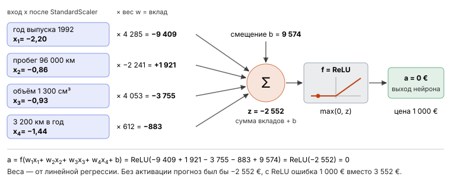

## Зачем это нужно

Нейронные сети распознают речь и лица, переводят тексты, на них построены языковые модели (модуль 9). Сеть состоит из множества одинаковых простых элементов — **искусственных нейронов**. Модель нейрона придумали Маккаллок и Питтс в 1943 году (урок 0.1), подсмотрев её у нервной клетки: клетка получает сигналы от соседей, одни сигналы усиливают её, другие гасят, и если суммарное возбуждение велико, клетка срабатывает.

Хорошая новость: половину нейрона вы уже знаете. Это взвешенная сумма признаков из линейной регрессии. Новое — только **функция активации**, которую нейрон применяет к сумме. Именно она делает сеть из нейронов гибче линейной модели.

## Модель нейрона



У нейрона есть **входы** x₁…xₙ (у нас — четыре признака машины), **веса** w₁…wₙ (по одному на вход) и **смещение** b (bias, свободный член). Нейрон считает взвешенную сумму и применяет к ней функцию активации f:

$$
z = w_1 x_1 + w_2 x_2 + \dots + w_n x_n + b, \qquad a = f(z)
$$

Возьмём веса и смещение у линейной регрессии из разминки и посчитаем нейрон для одной машины — ВАЗ-2105 1992 года:

```python
x = X_valid_s[3]                       # признаки машины после StandardScaler
print('Машина:', X_valid.iloc[3].to_dict(), '| цена:', y_valid.iloc[3])
print('Вклады w·x:', (w * x).round(0))
z = x @ w + b                          # взвешенная сумма плюс смещение
print('z =', round(z), '| ReLU(z) =', round(max(z, 0)))
```

`x @ w` — сумма попарных произведений двух векторов: (−2,20)·4 285 + (−0,86)·(−2 241) + … Старый год и маленький двигатель тянут сумму вниз, и вместе со смещением 9 574 получается z = −2 552. Линейная регрессия на этом бы остановилась и предсказала цену −2 552 евро. Нейрон с активацией **ReLU** заменяет отрицательную сумму нулём: прогноз 0 евро, ошибка 1 000 вместо 3 552.

## Все машины сразу: X @ w

Оператор `@` — **матричное умножение**. Если слева таблица X размером «строки × признаки», а справа вектор весов длиной «признаки», то `X @ w` умножает на веса каждую строку и даёт по одному числу на строку:

```python
z = X_valid_s @ w + b                  # (6414, 4) @ (4,) → (6414,)
print(X_valid_s.shape, '@', w.shape, '→', z.shape)
print('То же, что predict:', np.allclose(z, linear.predict(X_valid_s)))
a = np.maximum(z, 0)                   # ReLU для каждой машины
print('Нейрон выдаёт 0 у', (a == 0).sum(), 'машин из', len(a))
print('MAE без активации:', round(mean_absolute_error(y_valid, z)), '| с ReLU:', round(mean_absolute_error(y_valid, a)))
```

Без активации (точнее, с **тождественной** активацией f(z) = z) нейрон — в точности линейная регрессия: прогнозы совпадают с `predict`. ReLU «выключает» нейрон у 506 машин, где сумма отрицательная, и MAE падает с 4 270 до 3 975 евро. Веса мы при этом не меняли — только добавили нелинейность на выходе.

## Четыре функции активации

| Функция | Формула | Значения | Где встречается |
|---|---|---|---|
| ступенька (Хевисайда) | 1 при z > 0, иначе 0 | 0 или 1 | нейрон Маккаллока и Питтса |
| сигмоида | $1 / (1 + e^{-z})$ | от 0 до 1 | выход классификатора: вероятность |
| tanh | гиперболический тангенс | от −1 до 1 | скрытые слои |
| ReLU | max(0, z) | от 0 до +∞ | скрытые слои — самая частая |

```python
grid = np.linspace(-5, 5, 201)
curves = {
    'ступенька': (grid > 0).astype(float),
    'сигмоида': 1 / (1 + np.exp(-grid)),
    'tanh': np.tanh(grid),
    'ReLU': np.maximum(grid, 0),
}
fig, axes = plt.subplots(1, 4, figsize=(12, 3))
for ax, (name, values) in zip(axes, curves.items()):
    ax.plot(grid, values)
    ax.axhline(0, color='gray', linewidth=0.5)
    ax.axvline(0, color='gray', linewidth=0.5)
    ax.set_title(name)
    ax.set_xlabel('z')
plt.tight_layout()
plt.show()
```

Сигмоида — сглаженная ступенька: при больших положительных z она близка к 1, при больших отрицательных — к 0, при z = 0 равна 0,5. Tanh похож на сигмоиду, но симметричен относительно нуля. ReLU — проще всех: ноль для отрицательных z и сама сумма для положительных.

## Насыщение: где нейрон перестаёт учиться

Нейросеть учится градиентным спуском (урок 5.2): веса сдвигаются против градиента, а в градиент входит **наклон** функции активации — её производная. У ступеньки наклон равен нулю везде, кроме точки 0. Градиентный спуск не знает, куда двигать веса, поэтому в обучаемых сетях ступеньку заменили сигмоидой. Но и у сигмоиды есть ловушка. Её наклон равен σ(z)·(1 − σ(z)):

```python
def sigmoid(t):
    return 1 / (1 + np.exp(-t))

points = np.array([-10, -2, 0, 2, 10.0])
print('z:              ', points)
print('сигмоида:       ', sigmoid(points).round(4))
print('наклон сигмоиды:', (sigmoid(points) * (1 - sigmoid(points))).round(5))
print('наклон ReLU:    ', (points > 0).astype(float))
```

При z = 0 наклон сигмоиды 0,25, а при z = 10 — 0,000045, в 5 500 раз меньше. Нейрон с большой по модулю суммой **насыщен**: как ни меняй его веса, выход почти не меняется, и градиент почти нулевой. У ReLU наклон равен 1 для любой положительной суммы — одна из причин, почему её используют в скрытых слоях по умолчанию. Насыщение — ещё и причина масштабировать признаки: пробег в сотнях тысяч километров сразу загнал бы сигмоиду в насыщение.

## Нейрон как логический элемент

Маккаллок и Питтс показали: нейрон со ступенькой может вычислять логические операции. Входы — 0 или 1, выход — 1, если z > 0. Подберём веса для «И» (AND) и «ИЛИ» (OR) и переберём 729 нейронов с весами и смещением от −2 до 2:

```python
inputs = np.array([[0, 0], [0, 1], [1, 0], [1, 1]])

def step_neuron(X, weights, bias):
    return (X @ weights + bias > 0).astype(int)

print('AND:', step_neuron(inputs, np.array([1, 1]), -1.5))
print('OR: ', step_neuron(inputs, np.array([1, 1]), -0.5))

targets = {'AND': [0, 0, 0, 1], 'OR': [0, 1, 1, 1], 'XOR': [0, 1, 1, 0]}
found = {name: 0 for name in targets}
values = np.arange(-2, 2.01, 0.5)      # 9 значений для w1, w2 и смещения
for w1 in values:
    for w2 in values:
        for bias in values:
            out = step_neuron(inputs, np.array([w1, w2]), bias).tolist()
            for name, target in targets.items():
                found[name] += out == target
print('Из', len(values) ** 3, 'нейронов подходят:', found)
```

AND умеют 20 нейронов, OR — 30, а «исключающее ИЛИ» (XOR: 1, когда ровно один вход равен 1) — ни один. Дело не в сетке перебора. Нейрон выдаёт 1 по одну сторону прямой w₁x₁ + w₂x₂ + b = 0 и 0 — по другую. Точки (0, 1) и (1, 0) должны оказаться по одну сторону, а (0, 0) и (1, 1) — по другую, и одной прямой этого не сделать. В 1969 году Минский и Пейперт подробно разобрали это ограничение однослойного персептрона (урок 0.1).

Выход — поставить нейроны в два слоя. Первый слой считает OR и «не оба» (NAND), второй — AND от их выходов:

```python
hidden = np.column_stack([
    step_neuron(inputs, np.array([1, 1]), -0.5),      # OR: хотя бы один
    step_neuron(inputs, np.array([-1, -1]), 1.5),     # NAND: не оба сразу
])
print('Выходы первого слоя:\n', hidden)
print('XOR из трёх нейронов:', step_neuron(hidden, np.array([1, 1]), -1.5))
```

Три нейрона в два слоя решают то, что не может один. Это и есть нейронная сеть — урок 8.2.

## Типичные ошибки

:::mistake Забыть смещение
`z = X @ w` без `+ b` — нейрон обязан выдавать 0 при нулевых входах. После StandardScaler нулевые входы — это «средняя машина», и вместо средней цены 9 574 евро получился бы 0.
:::

:::mistake Перепутать порядок в `@`
`w @ X_valid_s` — ошибка формы: (4,) @ (6414, 4). Число столбцов матрицы слева должно совпадать с длиной вектора справа: `X_valid_s @ w`.
:::

:::mistake Немасштабированные признаки
Пробег в сотнях тысяч, год в тысячах: взвешенная сумма огромная, сигмоида и tanh сразу насыщаются, наклон почти 0 — нейрон не учится. Перед нейросетью признаки масштабируют (урок 5.7).
:::

:::mistake Сигмоида на выходе для цены
Сигмоида выдаёт числа от 0 до 1 — цену в евро так не предсказать. На выходе регрессии ставят тождественную активацию (или ReLU, если ответ не бывает отрицательным), сигмоиду — на выходе классификатора.
:::

## Мини-квиз

```quiz
- q: Чем нейрон с тождественной активацией f(z) = z отличается от линейной регрессии?
  options:
    - Ничем — это та же взвешенная сумма признаков плюс свободный член
    - Нейрон точнее, потому что у него есть смещение
    - Нейрон умеет только классификацию
  answer: 0
  explain: Мы проверили это в примере — прогнозы совпали с linear.predict. Новые возможности даёт только нелинейная активация.
- q: Взвешенная сумма нейрона z = −3. Что выдадут ReLU и сигмоида?
  options:
    - ReLU — 0, сигмоида — около 0,05
    - ReLU — −3, сигмоида — 0
    - ReLU — 3, сигмоида — около 0,95
  answer: 0
  explain: "ReLU заменяет отрицательное число нулём; сигмоида 1 / (1 + e³) ≈ 0,047 — близко к 0, но не 0."
- q: Почему ступенчатую функцию активации не используют в обучаемых сетях?
  options:
    - Её наклон равен нулю почти везде, и градиентный спуск не знает, куда сдвигать веса
    - Она слишком медленно считается
    - Она выдаёт отрицательные значения
  answer: 0
  explain: Поэтому её заменили на гладкую сигмоиду, а затем — на ReLU, у которой наклон для положительных сумм равен 1.
- q: Почему один нейрон не может вычислить XOR?
  options:
    - Нейрон делит плоскость входов прямой, а точки XOR одной прямой не разделить
    - Не хватает точности вычислений
    - Нужно взять веса больше 2
  answer: 0
  explain: "Перебор показал 0 подходящих нейронов. Решение — слой нейронов: OR и NAND, затем AND."
```

## Что запомнить

- Нейрон: z = x·w + b, a = f(z). Для всей таблицы сразу — `X @ w + b`: по числу на строку.
- С тождественной активацией нейрон — это линейная регрессия; новые возможности даёт нелинейная функция активации.
- ReLU = max(0, z) — основная активация скрытых слоёв; сигмоида (от 0 до 1) — на выходе классификатора; tanh — от −1 до 1; ступенька градиентом не обучается.
- При больших |z| у сигмоиды и tanh наклон почти нулевой (насыщение) — ещё одна причина масштабировать признаки.
- Один нейрон проводит прямую границу: AND и OR он умеет, XOR — нет. Для XOR нужны два слоя нейронов.
