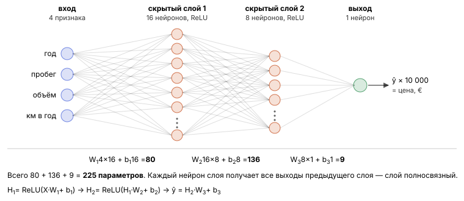

## Зачем это нужно

Один нейрон проводит прямую (урок 8.1), а цена машины от года растёт не по прямой. Медианная цена в train: 1 900 евро у машин 1995 года, около 6 800 — у машин 2010 года, 29 200 — у машин 2020 года. За первые 15 лет цена выросла примерно на 4 900 евро, а за следующие десять — на 22 000. Прямая с такой кривой не справится: где-то она завысит цену, а для старых машин уйдёт в минус.

В уроке 8.1 три нейрона в два слоя решили XOR, который не по силам одному нейрону. Так же устроены настоящие сети: нейроны ставят **слоями**, и выходы одного слоя становятся входами следующего. Такую сеть называют **многослойным персептроном** (MLP).

## Слои нейронов



Слои между входом и выходом называют **скрытыми**: их выходы не видны снаружи, это промежуточные признаки, которые сеть строит сама. Каждый нейрон слоя получает все выходы предыдущего слоя — слой **полносвязный**. Слой из 16 нейронов на 4 входа — это 16 взвешенных сумм сразу: веса образуют матрицу 4 × 16, а смещений 16, по одному на нейрон. Весь слой считается одним матричным умножением:

$$
\begin{gathered}
H_1 = \mathrm{ReLU}(X W_1 + b_1), \qquad H_2 = \mathrm{ReLU}(H_1 W_2 + b_2), \\
\hat y = H_2 W_3 + b_3
\end{gathered}
$$

На выходе регрессии активации нет: прогноз может быть любым числом. Посчитаем **прямой проход** (forward pass) для пяти машин со случайными весами:

```python
rng = np.random.default_rng(0)
W1, b1 = rng.normal(size=(4, 16)), np.zeros(16)     # слой 1: 4 входа → 16 нейронов
W2, b2 = rng.normal(size=(16, 8)), np.zeros(8)      # слой 2: 16 → 8
W3, b3 = rng.normal(size=(8, 1)), np.zeros(1)       # выход: 8 → 1
H1 = np.maximum(X_valid_s[:5] @ W1 + b1, 0)
H2 = np.maximum(H1 @ W2 + b2, 0)
out = H2 @ W3 + b3
print('Формы: X', X_valid_s[:5].shape, '→ H1', H1.shape, '→ H2', H2.shape, '→ выход', out.shape)
print('Прогнозы случайной сети:', out.ravel().round(2))
print('Настоящие цены / 10 000:', (y_valid.iloc[:5] / unit).round(2).tolist())
```

Каждая строка таблицы проходит через слои, и её признаки по дороге превращаются из 4 чисел в 16, затем в 8 и в один прогноз. Со случайными весами прогнозы бессмысленные — от −13 до 15 вместо 0,1…1,7. **Обучение** — это подбор всех весов и смещений так, чтобы прогнозы приблизились к ценам. Как именно — урок 8.3. Пока доверим его scikit-learn.

## MLPRegressor

```python
net = MLPRegressor(hidden_layer_sizes=(16, 8), activation='relu',
                   batch_size=256, max_iter=30, random_state=42)
net.fit(X_train_s, y_train / unit)                  # учим на цене в десятках тысяч евро
pred = net.predict(X_valid_s) * unit                # прогноз обратно в евро
print('MAE сети:', round(mean_absolute_error(y_valid, pred)))
print('MAE линейной регрессии:', round(mean_absolute_error(y_valid, linear.predict(X_valid_s))))
```

Те же четыре признака, а MAE падает с 4 270 до 2 826 евро. Параметры:

- `hidden_layer_sizes=(16, 8)` — два скрытых слоя, 16 и 8 нейронов. `(64,)` — один слой из 64 нейронов (запятая обязательна: это кортеж);
- `activation='relu'` — активация скрытых слоёв: `'relu'`, `'tanh'`, `'logistic'` (сигмоида) или `'identity'` (без нелинейности);
- `batch_size=256`, `max_iter=30` — как долго учить: 30 проходов по train порциями по 256 машин (урок 8.3);
- `random_state=42` — начальные случайные веса. Без него каждый запуск давал бы немного другую сеть.

Признаки масштабированы (урок 8.1: иначе нейроны насыщаются). Цену делим на 10 000: сеть начинает со случайных весов около нуля и выдаёт числа порядка единицы, и ей проще подстроиться под ответы того же порядка. Прогноз умножаем обратно — MAE считаем в евро.

## Веса сети: coefs_ и intercepts_

```python
print('Матрицы весов:', [W.shape for W in net.coefs_])
print('Смещения:', [bias.shape for bias in net.intercepts_])
n_params = sum(W.size for W in net.coefs_) + sum(bias.size for bias in net.intercepts_)
print('Всего параметров:', n_params)

H = X_valid_s
for W, bias in zip(net.coefs_[:-1], net.intercepts_[:-1]):
    H = np.maximum(H @ W + bias, 0)                 # скрытые слои с ReLU
manual = (H @ net.coefs_[-1] + net.intercepts_[-1]).ravel()
print('Прямой проход вручную совпадает с predict:', np.allclose(manual, net.predict(X_valid_s)))
```

Обученная сеть — это три матрицы весов и три вектора смещений, 225 чисел. Прямой проход по ним вручную даёт ровно `predict`: никакой магии внутри нет. Число параметров растёт быстро. У сети с двумя слоями по 64 нейрона их уже 4 545, и почти все сидят в матрице 64 × 64 между скрытыми слоями.

## Зачем нужна активация

Обучим одинаковые сети и поменяем только активацию скрытых слоёв:

```python
nets, rows = {}, {}
for act in ['identity', 'relu', 'tanh']:
    nets[act] = MLPRegressor(hidden_layer_sizes=(16, 8), activation=act, batch_size=256,
                             max_iter=30, random_state=42).fit(X_train_s, y_train / unit)
    rows[act] = {'train': mean_absolute_error(y_train, nets[act].predict(X_train_s) * unit),
                 'validation': mean_absolute_error(y_valid, nets[act].predict(X_valid_s) * unit)}
print(pd.DataFrame(rows).T.round(0))
```

С ReLU и tanh — 2 826 и 2 873 евро. Сеть с активацией `'identity'` — те же 225 параметров, — 4 320 евро, не лучше линейной регрессии (4 270). Причина — в алгебре. Без нелинейности каждый слой — умножение на матрицу плюс вектор, а несколько таких шагов подряд складываются в один: X·W₁·W₂·W₃ = X·W. Перемножим матрицы обученной сети:

```python
flat = nets['identity']
W = flat.coefs_[0] @ flat.coefs_[1] @ flat.coefs_[2]                       # 4 × 1
b_flat = (flat.intercepts_[0] @ flat.coefs_[1] + flat.intercepts_[1]) @ flat.coefs_[2] + flat.intercepts_[2]
print('Сеть без активации = одна взвешенная сумма:', np.allclose((X_valid_s @ W + b_flat).ravel(), flat.predict(X_valid_s)))
print('Её веса, €:          ', (W.ravel() * unit).round(0), '| смещение:', round(b_flat[0] * unit))
print('Линейная регрессия, €:', linear.coef_.round(0), '| смещение:', round(linear.intercept_))
```

225 параметров схлопнулись в 4 веса и смещение — почти те же, что у линейной регрессии (обе модели ищут лучшую прямую, просто разными способами). Слои дают гибкость, только если между ними стоит нелинейная активация.

## Прогноз по году выпуска

Посмотрим, как сети меняют прогноз. Возьмём типичную машину из train — объём 1,8 л, 14 417 км в год — и будем менять год выпуска (пробег пересчитываем по возрасту на 2022 год):

```python
years = np.arange(1995, 2022)
typical = X_train.median()
grid = pd.DataFrame({'Year': years, 'Distance': (2022 - years) * typical['km_year'],
                     'Engine': typical['Engine'], 'km_year': typical['km_year']})
G = scaler.transform(grid[features])
median_by_year = y_train.groupby(X_train['Year']).median().loc[1995:2021]

fig, ax = plt.subplots(figsize=(8, 4))
ax.plot(median_by_year.index, median_by_year, 'o', color='gray', label='медианная цена в train')
for act in ['identity', 'relu']:
    ax.plot(years, nets[act].predict(G) * unit, label=f'сеть, activation={act!r}')
ax.axhline(0, color='black', linewidth=0.5)
ax.set_xlabel('Год выпуска')
ax.set_ylabel('Цена, €')
ax.legend()
plt.show()
```

Сеть без активации рисует прямую: для машины 1995 года она предсказывает −3 162 евро, а для 2020 года — 19 534, хотя медиана — 29 200. Сеть с ReLU сгибает прогноз: 2 179 евро в 1995 году, полого до 2010 года и круто вверх после — 27 925 евро для 2020 года. Каждый нейрон ReLU «включается» с какого-то года, и сумма таких изломов складывается в кривую. (Серые точки — медианы всех машин года, с разными пробегами и объёмами; это ориентир, а не точный ответ для типичной машины.)

## Типичные ошибки

:::mistake Признаки без масштабирования
Та же сеть на исходных признаках даёт MAE 82 096 евро — в 29 раз хуже. Год ≈ 2 000 и пробег ≈ 180 000 насыщают нейроны (урок 8.1). StandardScaler, обученный на train, — обязательный шаг перед MLP.
:::

:::mistake Забыть вернуть прогноз в евро
Сеть учили на `y_train / 10000`, значит `predict` тоже выдаёт десятки тысяч евро. Без `* unit` MAE получится 9 615 — хуже, чем у прогноза одной средней ценой (6 527).
:::

:::mistake `activation='identity'` «для простоты»
Сеть без нелинейной активации — линейная модель, сколько бы слоёв и нейронов в ней ни было.
:::

:::mistake Сравнивать сети с разным random_state
Начальные веса случайные, и результат от них зависит: та же сеть (16, 8) с `random_state` от 0 до 4 даёт MAE от 2 797 до 2 905 евро. Сравнивая архитектуры, фиксируйте `random_state` — а разницу в несколько десятков евро не считайте победой.
:::

## Мини-квиз

```quiz
- q: Сколько параметров у сети 4 → 16 → 8 → 1?
  options:
    - "225: 4·16 + 16 + 16·8 + 8 + 8·1 + 1"
    - "29: 4 + 16 + 8 + 1 нейронов"
    - "512: 4 · 16 · 8"
  answer: 0
  explain: У каждого слоя матрица весов «входы × нейроны» и по смещению на нейрон.
- q: Почему сеть с activation='identity' не лучше линейной регрессии?
  options:
    - Без нелинейности слои складываются в одну взвешенную сумму X·W + b
    - Ей не хватило эпох обучения
    - У неё меньше параметров
  answer: 0
  explain: Произведение матриц — снова матрица. Гибкость дают только нелинейные активации между слоями.
- q: Сеть обучена на y_train / 10000. Как получить прогноз в евро?
  options:
    - net.predict(X_valid_s) * 10000
    - net.predict(X_valid_s * 10000)
    - net.predict(X_valid_s) / 10000
  answer: 0
  explain: Сеть выдаёт ответ в тех же единицах, на которых училась, — в десятках тысяч евро.
- q: Что хранится в net.coefs_[0] у сети с hidden_layer_sizes=(16, 8) на 4 признаках?
  options:
    - Матрица весов 4 × 16 первого скрытого слоя
    - 16 смещений первого слоя
    - Прогнозы первых 16 машин
  answer: 0
  explain: Смещения лежат отдельно, в net.intercepts_.
```

## Что запомнить

- MLP — слои нейронов: H = f(X·W + b) для каждого скрытого слоя, на выходе регрессии — взвешенная сумма без активации.
- `MLPRegressor(hidden_layer_sizes=(16, 8), activation='relu', random_state=42)`: признаки масштабируем, цену делим на 10 000, прогноз умножаем обратно.
- Веса слоёв — `net.coefs_` (матрицы «входы × нейроны»), смещения — `net.intercepts_`. У сети 4 → 16 → 8 → 1 их 225.
- Без нелинейной активации любая сеть сводится к линейной модели. ReLU позволяет сгибать прогноз: сеть снизила MAE с 4 270 до 2 826 евро.
