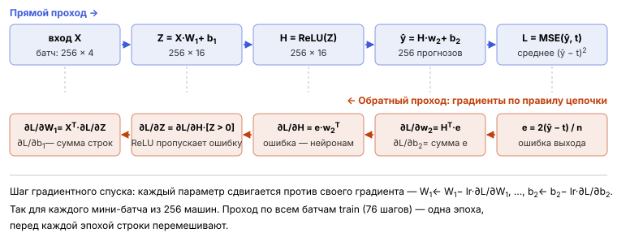

## Зачем это нужно

`net.fit(X, y)` подобрал 225 весов, и сеть стала предсказывать цену. Как? Тем же градиентным спуском, что и в уроке 5.2: потери, градиент, шаг против градиента. Новых вопросов два:

1. Как посчитать градиент по **каждому** весу, если между весом и потерями стоят несколько слоёв? Ответ — **обратное распространение ошибки** (backpropagation). Метод стал известен в 1986 году после статьи Румельхарта, Хинтона и Уильямса, и с тех пор так учатся почти все нейросети.
2. Считать градиент по всем 19 239 машинам на каждом шаге — дорого. Сети учатся по **мини-батчам**, порциями строк, и проходят train много раз — **эпохами**.

Разберём обе идеи на сети, которую напишем сами, а потом узнаем их в настройках MLPRegressor.

## Прямой и обратный проход

Возьмём сеть с одним скрытым слоем: 4 входа → 16 нейронов ReLU → 1 выход, 97 параметров. Прямой проход для батча X и потери — среднее квадратов ошибок:

$$
\begin{gathered}
Z = X W_1 + b_1, \qquad H = \mathrm{ReLU}(Z), \qquad \hat y = H w_2 + b_2, \\
L = \frac{1}{n}\sum (\hat y - t)^2
\end{gathered}
$$



Обратный проход идёт от потерь к входу и на каждом слое применяет правило цепочки:

- **ошибка выхода** e = ∂L/∂ŷ = 2(ŷ − t)/n — насколько и в какую сторону ошибся каждый прогноз;
- градиенты выходного слоя: ∂L/∂w₂ = Hᵀe (вес тем важнее, чем активнее его нейрон на строках с большой ошибкой), ∂L/∂b₂ — сумма e;
- ошибка доходит до скрытых нейронов пропорционально их весам: ∂L/∂H = e·w₂ᵀ;
- ReLU пропускает её только у активных нейронов, где Z > 0: у «выключенных» наклон ReLU равен нулю (урок 8.1);
- градиенты первого слоя: ∂L/∂W₁ = Xᵀ·∂L/∂Z, ∂L/∂b₁ — сумма ∂L/∂Z по строкам.

```python
def init(seed=42, hidden=16):
    rng = np.random.default_rng(seed)               # случайные начальные веса
    return {'W1': rng.normal(0, np.sqrt(2 / 4), size=(4, hidden)), 'b1': np.zeros(hidden),
            'w2': rng.normal(0, np.sqrt(1 / hidden), size=hidden), 'b2': 0.0}

def forward(p, X):
    Z = X @ p['W1'] + p['b1']
    H = np.maximum(Z, 0)
    return Z, H, H @ p['w2'] + p['b2']

def backward(p, X, t):
    Z, H, pred = forward(p, X)
    e = 2 * (pred - t) / len(t)                     # ошибка выхода ∂L/∂ŷ
    dZ = np.outer(e, p['w2']) * (Z > 0)             # ошибка скрытого слоя, только у активных нейронов
    return {'W1': X.T @ dZ, 'b1': dZ.sum(axis=0), 'w2': H.T @ e, 'b2': e.sum()}

params = init()
Xb, tb = X_train_s[:256], t_train[:256]             # первый батч из 256 машин
pred = forward(params, Xb)[2]
print('MSE на батче до обучения:', round(np.mean((pred - tb) ** 2), 4))
grads = backward(params, Xb, tb)
print('Формы градиентов:', {name: np.shape(g) for name, g in grads.items()})
```

У каждого параметра свой градиент той же формы: матрица 4 × 16 для W₁, по числу на нейрон для b₁ и w₂, одно число для b₂. Обратный проход стоит лишь в пару раз дороже прямого, сколько бы весов ни было, — поэтому можно обучать сети с миллионами весов.

## Проверка градиента

Формулы легко перепутать, поэтому их проверяют **численной производной**: чуть сдвинем один вес вверх и вниз и посмотрим, как меняются потери.

```python
def mse(p, X, t):
    return np.mean((forward(p, X)[2] - t) ** 2)

h = 1e-6
for name, pos in [('W1', (2, 5)), ('b1', 3), ('w2', 7)]:
    plus = {k: np.copy(v) for k, v in params.items()}
    minus = {k: np.copy(v) for k, v in params.items()}
    plus[name][pos] += h
    minus[name][pos] -= h
    numeric = (mse(plus, Xb, tb) - mse(minus, Xb, tb)) / (2 * h)
    print(f'{name}{pos}: обратное распространение {grads[name][pos]:.6f} | численно {numeric:.6f}')
```

Совпадение до шестого знака. Численная производная требует два прямых прохода на **каждый** вес — для 97 весов это 194 прохода против одного обратного. Поэтому ею только проверяют, а обучают обратным распространением.

## Эпохи и мини-батчи

**Полный градиентный спуск** делает один шаг по всем строкам train. **Мини-батчи**: строки перемешивают, режут на порции по `batch_size` и делают шаг на каждой порции. Один проход по всем порциям — **эпоха**. При 19 239 машинах и порциях по 256 эпоха — это 76 шагов: 75 полных батчей и последний из 39 машин.

```python
def train(batch_size, epochs=30, lr=0.05, seed=42):
    rng = np.random.default_rng(seed)
    p = init(seed)
    history = []
    for epoch in range(epochs):
        order = rng.permutation(len(X_train_s))     # каждая эпоха — в новом порядке
        for start in range(0, len(order), batch_size):
            idx = order[start:start + batch_size]
            g = backward(p, X_train_s[idx], t_train[idx])
            for name in p:
                p[name] = p[name] - lr * g[name]    # шаг против градиента
        history.append(mean_absolute_error(y_valid, forward(p, X_valid_s)[2] * unit))
    return p, history

curves = {}
for bs in [len(X_train_s), 256, 32]:
    _, curves[bs] = train(bs)
    print(f'batch_size={bs:5}: шагов за эпоху {int(np.ceil(len(X_train_s) / bs)):3}, '
          f'MAE после 1 эпохи {curves[bs][0]:.0f}, после 30 — {curves[bs][-1]:.0f}')

plt.figure(figsize=(8, 4))
for bs, hist in curves.items():
    plt.plot(range(1, 31), hist, label=f'batch_size={bs}')
plt.xlabel('Эпоха')
plt.ylabel('MAE на validation, €')
plt.legend()
plt.show()
```

Полный спуск за 30 эпох сделал 30 шагов и дошёл до 3 476 евро. Мини-батчи по 256 уже после **первой** эпохи дают 3 148: 76 небольших шагов полезнее одного точного. Цена — шум. Каждый батч тянет веса в свою сторону, и с постоянным шагом кривая дальше колеблется около 3 100. С батчами по 32 шагов в 8 раз больше, и MAE опускается до 2 841. Так вся сеть обучилась за доли секунды.

:::tip Почему «стохастический» спуск
Градиент по случайному батчу — шумная, но несмещённая оценка градиента по всему train. Поэтому спуск по мини-батчам называют стохастическим (SGD). Оптимизаторы вроде Adam гасят этот шум: они подбирают шаг каждого веса по истории его градиентов.
:::

## То же самое в MLPRegressor

```python expect-warning
net = MLPRegressor(hidden_layer_sizes=(16,), batch_size=256, max_iter=30, random_state=42)
net.fit(X_train_s, t_train)
print('Эпох:', net.n_iter_, '| шагов:', net.n_iter_ * int(np.ceil(len(X_train_s) / 256)))
print('Потери на train после эпох 1, 6, 11, …:', np.round(net.loss_curve_[::5], 4))
print('MAE на validation:', round(mean_absolute_error(y_valid, net.predict(X_valid_s) * unit)))
```

Это та же сеть 4 → 16 → 1, только вместо нашего спуска — оптимизатор Adam (`solver='adam'` по умолчанию, базовый шаг `learning_rate_init=0.001`): 2 921 евро. Параметры обучения:

- `batch_size` — размер мини-батча, `max_iter` — наибольшее число **эпох** (не шагов!);
- `shuffle=True` (по умолчанию) — перемешивать строки перед каждой эпохой;
- `loss_curve_` — потери на train после каждой эпохи. Это половина MSE в единицах цены / 10 000 плюс небольшой штраф за большие веса (урок 8.5), а не MAE в евро.

Красная надпись — **ConvergenceWarning**: «достигнуто максимальное число итераций (30), а оптимизация ещё не сошлась». Это не ошибка. Эпохи кончились, а потери всё ещё заметно падали — сеть можно учить дольше. При `max_iter=100` у сети (16, 8) из урока 8.2 MAE на validation 2 760 вместо 2 826. При `max_iter=300` обучение само остановится на 136-й эпохе, когда потери 10 эпох подряд почти не меняются (`n_iter_no_change=10`, `tol=0.0001`), и MAE будет 2 783 — дольше не значит лучше (урок 8.5). В уроках мы сознательно учим 30 эпох и прячем это предупреждение.

## Эпоха за эпохой: partial_fit

`partial_fit` делает ровно одну эпоху. Удобно, чтобы после каждой эпохи смотреть на validation:

```python
warnings.filterwarnings('ignore', category=ConvergenceWarning)   # знаем, что учим не до конца
net = MLPRegressor(hidden_layer_sizes=(16, 8), batch_size=256, random_state=42)
history = []
for epoch in range(40):
    net.partial_fit(X_train_s, t_train)             # одна эпоха
    history.append(mean_absolute_error(y_valid, net.predict(X_valid_s) * unit))
best = int(np.argmin(history))
print('MAE после эпох 1, 6, 11, …:', [round(v) for v in history[::5]])
print('Лучшая эпоха:', best + 1, '| MAE:', round(history[best]))
plt.figure(figsize=(8, 3))
plt.plot(range(1, 41), history)
plt.xlabel('Эпоха')
plt.ylabel('MAE на validation, €')
plt.show()
```

После первой эпохи — 8 378 евро, после шестой — 3 162, дальше медленное улучшение до 2 835 к сороковой. Такая кривая — главный инструмент в уроке 8.5: по ней решают, когда остановить обучение. Результат после 30 эпох (2 847) немного отличается от `fit(max_iter=30)` (2 826). `partial_fit` при каждом вызове заново создаёт генератор случайных чисел из `random_state` и перемешивает строки в одном и том же порядке, а `fit` — в разном.

## Типичные ошибки

:::mistake Не перемешивать строки
Если train отсортирован (например, по году), батчи получаются однородными: сначала шаги тянут сеть к старым машинам, потом к новым. В своём цикле перемешивайте строки перед каждой эпохой; в MLPRegressor это делает `shuffle=True`.
:::

:::mistake Неудачный шаг обучения
В нашем спуске с батчами по 256 шаг 0,05 даёт 3 117 евро после 30 эпох. Шаг 0,001 учит слишком медленно (3 351), шаг 0,3 — скачет (4 362), а при шаге 0,5 веса «разлетаются» и прогнозы превращаются в NaN.
:::

:::mistake Путать эпоху и шаг
`max_iter=30` в MLPRegressor — 30 эпох. При `batch_size=256` и 19 239 строках это 2 280 шагов градиентного спуска.
:::

:::mistake Сравнивать loss_curve_ с MAE
`loss_curve_` — потери на train в единицах (цена / 10 000)², по ним модели не выбирают. Модель выбирают по метрике в евро на validation.
:::

## Мини-квиз

```quiz
- q: Сколько шагов градиентного спуска делает сеть за одну эпоху при 19 239 строках train и batch_size=256?
  options:
    - "76: 75 полных батчей и один из 39 строк"
    - "1"
    - "19 239"
    - "256"
  answer: 0
  explain: Эпоха — проход по всем строкам порциями по batch_size; на каждой порции — свой шаг.
- q: Что делает обратное распространение ошибки?
  options:
    - Считает градиенты потерь по всем весам — от выхода к входу, по правилу цепочки
    - Само обновляет веса, заменяя градиентный спуск
    - Перемешивает строки перед эпохой
  answer: 0
  explain: Обратное распространение даёт градиенты, а шаг по ним делает градиентный спуск (или Adam).
- q: Сумма Z нейрона ReLU на строке отрицательная. Чему равен вклад этой строки в градиент его входных весов?
  options:
    - Нулю — нейрон выключен, и небольшое изменение его весов не меняет выход
    - Он максимален
    - Он равен ошибке выхода
  answer: 0
  explain: Наклон ReLU при отрицательной сумме равен 0 — множитель [Z > 0] обнуляет ошибку.
- q: После fit с max_iter=30 появилось ConvergenceWarning. Что это значит?
  options:
    - Эпохи кончились, а потери ещё падали — модель рабочая, но её можно учить дольше
    - Обучение завершилось ошибкой, модель использовать нельзя
    - Сеть переобучилась
  answer: 0
  explain: "Это предупреждение, а не ошибка. Учить ли дольше — решают по validation: больше эпох не всегда лучше."
```

## Что запомнить

- Обучение сети — повторение цикла: прямой проход → потери → обратное распространение → шаг против градиента для всех весов.
- Обратное распространение считает градиенты от выхода к входу по правилу цепочки: ошибка выхода e передаётся назад через веса, ReLU пропускает её только у активных нейронов. Формулы проверяют численной производной.
- Мини-батч — порция строк для одного шага, эпоха — проход по всему перемешанному train. Мини-батчи дают много шагов за эпоху; цена — шумная кривая.
- В MLPRegressor: `batch_size`, `max_iter` (эпохи), `learning_rate_init`, `loss_curve_`, `partial_fit` — одна эпоха. ConvergenceWarning — эпохи кончились раньше, чем потери перестали падать.
