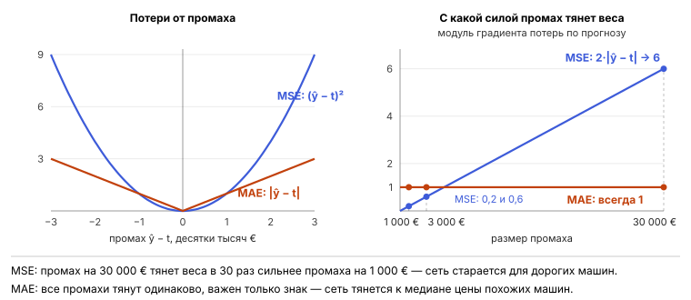

## Зачем это нужно

Сеть учится уменьшать **функцию потерь**, а оцениваем мы её по **метрике**. Это разные вещи. До сих пор сеть училась на MSE, а мы мерили MAE в евро. Если для задачи важна средняя ошибка в евро, может, и учить сеть стоит на MAE?

В ноутбуке курса это сформулировано так: для MSE ошибка в 3 000 евро даёт в 9 раз больший вклад, чем ошибка в 1 000, для MAE — в 3 раза. Значит, потеря определяет, **какие ошибки сеть исправляет в первую очередь**. Проверим, к чему это приводит.

## Что минимизирует каждая потеря

Начнём с самой простой «модели» — одного числа для всех машин. Какое число лучше всего по MSE, а какое по MAE?

```python
consts = np.arange(0, 30001, 100)
mse_c = [np.mean((y_train - c) ** 2) for c in consts]
mae_c = [np.mean(np.abs(y_train - c)) for c in consts]
print('Лучшая константа по MSE:', consts[np.argmin(mse_c)], '| средняя цена train:', round(y_train.mean()))
print('Лучшая константа по MAE:', consts[np.argmin(mae_c)], '| медиана цены train:', y_train.median())
for name, c in [('среднюю', y_train.mean()), ('медиану', y_train.median())]:
    print(f'Прогноз «всем {name}»: MAE на validation {mean_absolute_error(y_valid, np.full(len(y_valid), c)):.0f}')
```

MSE минимальна при **средней** цене (9 574 евро), MAE — при **медиане** (6 800). Цены скошены вправо: немного дорогих машин поднимают среднее над медианой. MSE ради них сдвигает прогноз вверх, MAE их почти не замечает. Сеть делает то же самое, только для каждой группы похожих машин: с MSE она ищет среднюю цену похожих машин, с MAE — медианную.

## Градиент: размер промаха или только знак

Сила, с которой каждая машина тянет веса, — это ошибка выхода из урока 8.3, производная потерь по прогнозу:

$$
\text{MSE:}\;\; \frac{\partial L}{\partial \hat y_i} = \frac{2(\hat y_i - t_i)}{n}, \qquad\qquad \text{MAE:}\;\; \frac{\partial L}{\partial \hat y_i} = \frac{\operatorname{sign}(\hat y_i - t_i)}{n}
$$



```python
def output_error(pred, t, loss):
    """Ошибка выхода ∂L/∂ŷ для каждой строки батча."""
    if loss == 'mse':
        return 2 * (pred - t) / len(t)      # пропорциональна промаху
    return np.sign(pred - t) / len(t)       # только знак промаха

miss = np.array([1000, 3000, 30000]) / unit  # промахи на три машины
for loss in ['mse', 'mae']:
    e = output_error(miss, np.zeros(3), loss)
    print(loss.upper(), '— во сколько раз сильнее тянет веса, чем промах на 1 000 €:', (e / e[0]).round(1))
```

С MSE промах на 30 000 евро весит как 30 промахов на 1 000 — сеть в первую очередь исправляет дорогие машины, где промахи большие. С MAE каждая машина голосует с одинаковой силой, «выше» или «ниже», и сеть тянется к медиане.

## Две сети: MSE и MAE

`MLPRegressor` умеет учиться только на квадратичной потере (и на пуассоновской), поэтому возьмём свою сеть 4 → 16 → 1 из урока 8.3 и подставим в неё `output_error`. Шаги будет делать **Adam**, как в MLPRegressor. С простым спуском сравнение было бы нечестным: градиенты MSE и MAE разного масштаба, и один и тот же шаг для них не равноценен.

```python
def init(seed=42, hidden=16):
    rng = np.random.default_rng(seed)
    return {'W1': rng.normal(0, np.sqrt(2 / 4), size=(4, hidden)), 'b1': np.zeros(hidden),
            'w2': rng.normal(0, np.sqrt(1 / hidden), size=hidden), 'b2': 0.0}

def forward(p, X):
    Z = X @ p['W1'] + p['b1']
    H = np.maximum(Z, 0)
    return Z, H, H @ p['w2'] + p['b2']

def backward(p, X, t, loss):
    Z, H, pred = forward(p, X)
    e = output_error(pred, t, loss)                 # единственное отличие MSE от MAE
    dZ = np.outer(e, p['w2']) * (Z > 0)
    return {'W1': X.T @ dZ, 'b1': dZ.sum(axis=0), 'w2': H.T @ e, 'b2': e.sum()}

def train_net(loss, epochs=30, lr=0.003, batch_size=256, seed=42):
    rng = np.random.default_rng(seed)
    p = init(seed)
    m = {k: np.zeros_like(v) for k, v in p.items()}   # Adam: скользящее среднее градиентов
    v = {k: np.zeros_like(v) for k, v in p.items()}   # и их квадратов
    step = 0
    for epoch in range(epochs):
        order = rng.permutation(len(X_train_s))
        for start in range(0, len(order), batch_size):
            idx = order[start:start + batch_size]
            g = backward(p, X_train_s[idx], t_train[idx], loss)
            step += 1
            for k in p:
                m[k] = 0.9 * m[k] + 0.1 * g[k]
                v[k] = 0.999 * v[k] + 0.001 * g[k] ** 2
                p[k] = p[k] - lr * (m[k] / (1 - 0.9 ** step)) / (np.sqrt(v[k] / (1 - 0.999 ** step)) + 1e-8)
    return p

nets = {loss: train_net(loss) for loss in ['mse', 'mae']}
preds = {loss: forward(p, X_valid_s)[2] * unit for loss, p in nets.items()}
print('Обе сети обучены, прогнозы на validation в евро готовы.')
```

Adam делит шаг каждого веса на «типичный размер» его градиента (корень из `v`). Поэтому масштаб градиента не важен, и обе сети учатся одинаково быстро. Теперь сравним их в одних единицах — в евро. Значения самих потерь не сравнивают: MSE измеряется в квадратах цены, MAE — в евро.

```python
expensive = (y_valid > y_train.quantile(0.9)).to_numpy()   # дорогие: дороже 90 % машин train
rows = {}
for loss, pred in preds.items():
    err = y_valid.to_numpy() - pred
    rows[f'потери {loss.upper()}'] = {
        'MAE': np.abs(err).mean(),
        'RMSE': np.sqrt((err ** 2).mean()),
        'MAE дорогих': np.abs(err[expensive]).mean(),
        'медиана |ошибки|': np.median(np.abs(err)),
        'средний прогноз': pred.mean(),
    }
print('Дорогих машин в validation:', expensive.sum(), '| граница:', round(y_train.quantile(0.9)))
print(pd.DataFrame(rows).round(0))
```

| | потери MSE | потери MAE |
|---|---:|---:|
| MAE | 2 940 | **2 773** |
| RMSE | **5 559** | 5 730 |
| MAE дорогих | **9 305** | 9 827 |
| медиана модуля ошибки | 1 794 | **1 507** |
| средний прогноз | 9 758 | 9 138 |

Победители разные. Сеть с MAE-потерей точнее «в среднем по машинам»: MAE меньше на 167 евро, медианная ошибка — на 287. Сеть с MSE-потерей лучше там, где промахи крупные: меньше RMSE (она сильнее штрафует большие ошибки) и ошибка на 662 дорогих машинах. Её средний прогноз выше — 9 758 против 9 138 при средней цене 9 616: дорогие машины подтягивают её прогнозы вверх. Мы проверили с другими начальными весами: направление всех четырёх различий не меняется.

## Где выигрывает каждая

Разделим машины validation на три равные по ценам группы — границы по train:

```python
low, high = y_train.quantile([1 / 3, 2 / 3])
groups = pd.cut(y_valid, bins=[-np.inf, low, high, np.inf], labels=['дешёвые', 'средние', 'дорогие'])
errors = pd.DataFrame({f'потери {loss.upper()}': np.abs(y_valid.to_numpy() - pred) for loss, pred in preds.items()},
                      index=y_valid.index)
by_group = errors.groupby(groups, observed=True).mean()
print(f'Границы групп по train: {low:.0f} и {high:.0f} €')
print(by_group.round(0))
by_group.plot.bar(figsize=(7, 3.5), rot=0, ylabel='MAE, €', title='Ошибка по ценовым группам')
plt.show()
```

Вся разница — в дешёвых машинах (до 4 600 евро): 1 231 евро у сети с MAE против 1 805 у сети с MSE. На средних они равны, на дорогих (дороже 9 700 евро) MSE немного точнее: 5 293 против 5 378. Сеть с MSE, подтянутая дорогими машинами, завышает цены дешёвых: она переоценивает 59 % машин validation, а сеть с MAE — 52 %.

## Как выбрать потерю

- Потерю выбирают под метрику задачи. Если важна средняя ошибка в евро на типичной машине — MAE. Если особенно дороги крупные промахи (дорогие машины, большие суммы) — MSE.
- Сравнивают по нескольким метрикам в одних единицах (евро) и по группам: одна сеть редко выигрывает во всём.
- В `MLPRegressor` параметр `loss` бывает только `'squared_error'` (по умолчанию) или `'poisson'`. MAE и промежуточная потеря Хьюбера (квадрат для малых промахов, модуль для больших) есть в библиотеках глубокого обучения — Keras и PyTorch — или в своём цикле, как здесь.

## Типичные ошибки

:::mistake Сравнивать значения разных потерь
MSE в квадратах (цены / 10 000), MAE — в десятках тысяч евро: числа несравнимы. Сравнивают модели по общим метрикам в евро.
:::

:::mistake Ждать победы по всем метрикам
Сеть, которая лучше по MAE, может быть хуже по RMSE и на дорогих машинах — так и вышло. Сначала решите, какая ошибка важна для задачи.
:::

:::mistake Сравнивать потери простым спуском с одинаковым шагом
Градиент MAE от каждой строки — 1/n, градиент MSE — 2·промах/n. С одним и тем же шагом SGD одна из сетей учится «быстрее», и вывод зависит от выбранного шага. Adam нормирует шаг, поэтому сравнение честнее.
:::

## Мини-квиз

```quiz
- q: Какое одно число для всех машин минимизирует MSE, а какое — MAE?
  options:
    - MSE — средняя цена, MAE — медиана
    - MSE — медиана, MAE — средняя цена
    - Обе — средняя цена
  answer: 0
  explain: 9 574 и 6 800 евро. С сетью то же самое, только для каждой группы похожих машин.
- q: Промах на 30 000 евро против промаха на 1 000 евро. Во сколько раз сильнее он тянет веса при MSE и при MAE?
  options:
    - В 30 раз при MSE, одинаково при MAE
    - В 900 раз при MSE, в 30 раз при MAE
    - Одинаково при обеих потерях
  answer: 0
  explain: Градиент MSE пропорционален промаху (сама потеря растёт в 900 раз), градиент MAE — только знак промаха.
- q: На каких машинах сеть с MAE-потерей выиграла больше всего?
  options:
    - На дешёвых — 1 231 евро против 1 805
    - На дорогих
    - Одинаково на всех
  answer: 0
  explain: Сеть с MSE, подтянутая дорогими машинами, завышает цены дешёвых.
- q: Можно ли обучить MLPRegressor на MAE-потере?
  options:
    - Нет — только 'squared_error' или 'poisson'; MAE — в своей сети, Keras или PyTorch
    - Да, loss='absolute_error'
    - Да, если задать activation='identity'
  answer: 0
  explain: Поэтому в уроке мы взяли свою сеть на NumPy.
```

## Что запомнить

- Потеря определяет, к чему тянется прогноз: MSE — к среднему, MAE — к медиане цены похожих машин.
- Градиент MSE пропорционален промаху — крупные промахи (дорогие машины) тянут веса сильнее; градиент MAE — только знак промаха.
- Сеть с MAE-потерей: MAE 2 773 против 2 940, медианная ошибка 1 507 против 1 794, особенно точнее на дешёвых машинах. Сеть с MSE: RMSE 5 559 против 5 730 и точнее на дорогих.
- Потерю выбирают под метрику задачи, а модели сравнивают по общим метрикам в евро и по группам.
