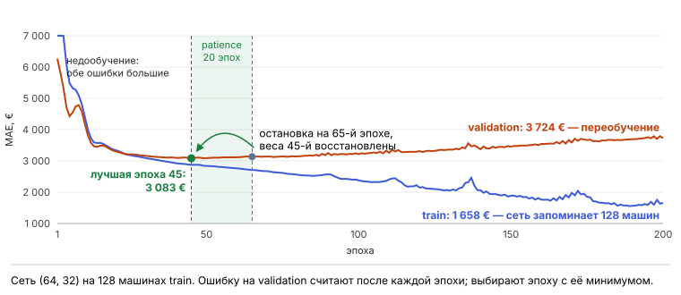

## Зачем это нужно

До сих пор мы учили сети ровно 30 эпох. Почему 30? Число эпох — такой же гиперпараметр, как глубина дерева (урок 6.5). Слишком мало эпох — сеть **недообучена**: ошибается и на train, и на validation. Слишком много — **переобучена**: всё лучше запоминает обучающие машины и всё хуже предсказывает новые.

На 19 239 машинах и четырёх признаках сеть (16, 8) переобучается слабо. Чтобы увидеть эффект за минуту, сделаем как в ноутбуке курса: оставим в train всего **128 машин** и возьмём сеть пошире — (64, 32), 2 433 параметра, по 19 на каждую машину. Validation — прежняя, все 6 414 машин.

## Кривые обучения

```python
net = MLPRegressor(hidden_layer_sizes=(64, 32), learning_rate_init=0.003, batch_size=32, random_state=42)
rows = []
for epoch in range(1, 201):
    net.partial_fit(X_small, y_small / unit)                 # одна эпоха (урок 8.3)
    rows.append({'train': mean_absolute_error(y_small, net.predict(X_small) * unit),
                 'validation': mean_absolute_error(y_valid, net.predict(X_valid_s) * unit)})
curves = pd.DataFrame(rows, index=pd.RangeIndex(1, 201, name='эпоха'))
best = curves['validation'].idxmin()
print(curves.loc[[1, 10, 20, best, 100, 200]].round(0))

ax = curves.plot(figsize=(8, 4), ylabel='MAE, €')
ax.axvline(best, color='gray', linestyle='--', label=f'минимум validation: эпоха {best}')
ax.legend()
plt.show()
```



Три участка:

- **эпохи 1–20 — недообучение.** Обе ошибки большие и быстро падают: 8 574 и 6 270 евро после первой эпохи, 3 346 и 3 308 после двадцатой;
- **около 45-й эпохи — лучшая сеть.** На validation минимум — 3 083 евро;
- **дальше — переобучение.** Ошибка на train падает до 1 658 евро, а на validation растёт до 3 724. Сеть подгоняется под шум 128 конкретных машин.

Если выбирать эпоху по train, выбор пал бы на 189-ю эпоху (1 555 евро на train) — и на validation было бы 3 689. Эпоху, как и любой гиперпараметр, выбирают по validation.

## Ранняя остановка: patience

Учить 200 эпох, чтобы потом выбрать 45-ю, — расточительно. **Ранняя остановка** (early stopping) следит за validation после каждой эпохи. Если ошибка не улучшалась `patience` эпох подряд, обучение останавливают. Терпение нужно потому, что кривая шумная: одна неудачная эпоха ещё не значит, что улучшений больше не будет. Применим правило к уже записанной кривой:

```python
def stop_epoch(curve, patience):
    """Эпоха остановки и лучшая эпоха для правила «ждать patience эпох без улучшения»."""
    best_epoch, best_value = 1, curve[0]
    for epoch, value in enumerate(curve, start=1):
        if value < best_value:
            best_epoch, best_value = epoch, value
        elif epoch - best_epoch >= patience:
            return epoch, best_epoch
    return len(curve), best_epoch

valid_curve = curves['validation'].tolist()
for patience in [3, 20, 60]:
    stop, best_ep = stop_epoch(valid_curve, patience)
    print(f'patience={patience:2}: остановка на эпохе {stop:3}, лучшая эпоха {best_ep:2}, MAE {valid_curve[best_ep - 1]:.0f}')
```

С `patience=20` обучение остановится на 65-й эпохе, с `patience=60` — на 105-й, и в обоих случаях лучшей окажется 45-я. А `patience=3` слишком нетерпелив: в начале кривая на пару эпох пошла вверх (4 427 евро на 5-й эпохе, 4 785 на 8-й), и обучение оборвалось на 8-й эпохе с MAE 4 427 — далеко от возможных 3 083.

## Восстановить лучшие веса

Остановившись на 65-й эпохе, мы держим в руках сеть 65-й эпохи, а лучшая была 20 эпох назад. Поэтому вместе с остановкой **запоминают копию лучшей сети** и в конце возвращают её (в Keras — `restore_best_weights=True`):

```python
net = MLPRegressor(hidden_layer_sizes=(64, 32), learning_rate_init=0.003, batch_size=32, random_state=42)
patience = 20
best_mae, best_epoch, best_net, wait = np.inf, 0, None, 0
for epoch in range(1, 201):
    net.partial_fit(X_small, y_small / unit)
    mae = mean_absolute_error(y_valid, net.predict(X_valid_s) * unit)
    if mae < best_mae:
        best_mae, best_epoch, best_net, wait = mae, epoch, copy.deepcopy(net), 0   # новая лучшая — запоминаем копию
    else:
        wait += 1
        if wait >= patience:
            break
print('Остановились на эпохе', epoch, '| лучшая эпоха', best_epoch)
print('MAE сети последней эпохи:', round(mean_absolute_error(y_valid, net.predict(X_valid_s) * unit)))
print('MAE восстановленной сети:', round(mean_absolute_error(y_valid, best_net.predict(X_valid_s) * unit)))
```

`copy.deepcopy` делает независимую копию сети со всеми весами — дальнейшее обучение `net` её не меняет. Восстановленная сеть — 3 083 евро, сеть 65-й эпохи — 3 134, а после всех 200 эпох было бы 3 724. Обучение заняло 65 эпох вместо 200.

## early_stopping в MLPRegressor

В scikit-learn ранняя остановка встроена. Вернёмся к полному train:

```python
net = MLPRegressor(hidden_layer_sizes=(16, 8), batch_size=256, max_iter=300, random_state=42,
                   early_stopping=True, validation_fraction=0.1, n_iter_no_change=10)
net.fit(X_train_s, y_train / unit)
print('Пройдено эпох:', net.n_iter_, '| лучшая эпоха:', int(np.argmax(net.validation_scores_)) + 1)
print('Лучший R² на отложенной части train:', round(net.best_validation_score_, 4))
print('MAE на validation:', round(mean_absolute_error(y_valid, net.predict(X_valid_s) * unit)))
```

Что происходит внутри:

- `validation_fraction=0.1` — сеть сама откладывает 10 % **train** и после каждой эпохи считает на них качество. Наша validation остаётся честной: сеть её не видит;
- следит она не за MAE, а за R² — метод `score` регрессора, `validation_scores_` хранит его по эпохам;
- `n_iter_no_change=10` — это patience: остановка, если 10 эпох подряд R² не улучшился хотя бы на `tol`;
- в конце сеть возвращает веса лучшей эпохи.

Сеть прошла 92 эпохи, лучшей была 81-я, MAE на validation — 2 780 евро. Это лучше, чем ровно 30 эпох (2 826 в уроке 8.2), и не нужно гадать с `max_iter`.

## Вторая защита: штраф alpha

Переобученная сеть часто держит огромные веса и подгоняет каждую обучающую точку. Как в Ridge (урок 7.6), можно штрафовать сумму квадратов весов: параметр `alpha` добавляет штраф к потерям. По умолчанию `alpha=0.0001` — почти ничего. Обучим широкую сеть на 128 машинах 200 эпох с разными штрафами:

```python
rows = {}
for alpha in [0.0001, 0.01, 0.1, 1.0, 3.0]:
    m = MLPRegressor(hidden_layer_sizes=(64, 32), learning_rate_init=0.003, batch_size=32,
                     max_iter=200, n_iter_no_change=200, alpha=alpha, random_state=42).fit(X_small, y_small / unit)
    rows[alpha] = {'train': mean_absolute_error(y_small, m.predict(X_small) * unit),
                   'validation': mean_absolute_error(y_valid, m.predict(X_valid_s) * unit),
                   'сумма квадратов весов': sum((W ** 2).sum() for W in m.coefs_)}
print(pd.DataFrame(rows).T.round(1))
```

`n_iter_no_change=200` не даёт обучению остановиться раньше: все сети проходят 200 эпох. С ростом `alpha` веса уменьшаются: сумма квадратов падает со 119 до 7 при `alpha=1`. Ошибка на train растёт (1 640 → 3 333), а на validation падает с 3 628 до 3 129 — почти как у ранней остановки. При `alpha=3` штраф уже мешает учиться: 3 442. Значит, `alpha` тоже подбирают по validation.

## Типичные ошибки

:::mistake Выбирать эпоху по train
Ошибка на train падает почти всё время, и по ней лучшей будет одна из последних эпох — то есть самая переобученная сеть: 3 689 евро на validation вместо 3 083.
:::

:::mistake Слишком маленький patience
Кривая на validation шумная. При `patience=3` обучение оборвалось на 8-й эпохе — сеть недообучена (4 427 евро). Обычно patience — 10–30 эпох, а при маленьком train и шумной кривой — больше.
:::

:::mistake Остановиться, но не вернуть лучшие веса
После остановки сеть — это сеть последней эпохи, на `patience` эпох хуже лучшей. Запоминайте копию лучшей сети (`copy.deepcopy`) или используйте `early_stopping=True`, который делает это сам.
:::

:::mistake Останавливать по test
Validation, по которой остановили обучение, уже участвовала в выборе — как при подборе гиперпараметров. Итоговую оценку получают на test, один раз (урок 8.6).
:::

## Мини-квиз

```quiz
- q: Ошибка на train продолжает падать, а на validation с 45-й эпохи растёт. Что это?
  options:
    - Переобучение — сеть подгоняется под шум обучающих машин
    - Недообучение — сети не хватает эпох
    - Ошибка в коде
  answer: 0
  explain: Лучшую эпоху выбирают по минимуму validation — здесь 45-я.
- q: Зачем ранней остановке параметр patience?
  options:
    - Кривая шумная, и одна-две неудачные эпохи ещё не значат, что улучшений не будет
    - Чтобы обучение шло быстрее
    - Чтобы сеть не видела validation
  answer: 0
  explain: При patience=3 обучение оборвалось на 8-й эпохе из-за случайного всплеска кривой.
- q: Что делает early_stopping=True в MLPRegressor?
  options:
    - Откладывает часть train, следит за R² на ней, останавливает обучение и возвращает лучшие веса
    - Следит за ошибкой на test
    - Уменьшает число нейронов
  answer: 0
  explain: Отложенная доля — validation_fraction, терпение — n_iter_no_change.
- q: Как alpha в MLPRegressor борется с переобучением?
  options:
    - Штрафует большие веса, как Ridge, — сеть не может подогнать каждую точку
    - Уменьшает число эпох
    - Удаляет лишние признаки
  answer: 0
  explain: Слишком большой alpha мешает учиться (alpha=3 — 3 442 евро), поэтому его подбирают по validation.
```

## Что запомнить

- Число эпох — гиперпараметр: мало эпох — недообучение (обе ошибки большие), много — переобучение (train падает, validation растёт). Выбирают по validation.
- Ранняя остановка: после каждой эпохи смотрим validation; нет улучшения `patience` эпох подряд — стоп. Слишком маленький patience обрывает обучение на шуме.
- После остановки возвращают веса лучшей эпохи: `copy.deepcopy` лучшей сети или `restore_best_weights=True` в Keras.
- `MLPRegressor(early_stopping=True, validation_fraction=0.1, n_iter_no_change=10)` делает всё это сам на отложенной части train и следит за R².
- `alpha` — штраф за большие веса, вторая защита от переобучения; его, как и patience, подбирают по validation.
