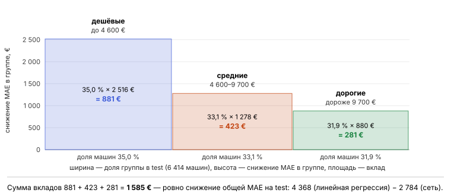

## Зачем это нужно

В модуле мы перепробовали архитектуры, активации, потери, число эпох. Пора выбрать **одну** сеть и честно ответить на два вопроса: насколько она точнее простой модели на новых машинах и **за счёт каких машин** она точнее. Порядок тот же, что в модуле 6 (урок 6.7): кандидатов сравнивают на validation, а на test проверяют один раз — выбранную модель.

## Кандидаты и выбор по validation

Три сети с ReLU, у каждой ранняя остановка (урок 8.5): сеть сама откладывает 10 % train и возвращает веса лучшей эпохи.

```python
candidates = {'relu (16, 8)': (16, 8), 'relu (32, 16)': (32, 16), 'relu (64,)': (64,)}
nets, rows = {}, {}
for name, hidden in candidates.items():
    nets[name] = MLPRegressor(hidden_layer_sizes=hidden, batch_size=256, max_iter=300, random_state=42,
                              early_stopping=True, n_iter_no_change=10).fit(X_train_s, y_train / unit)
    rows[name] = {'эпох': nets[name].n_iter_,
                  'MAE validation': mean_absolute_error(y_valid, nets[name].predict(X_valid_s) * unit)}
table = pd.DataFrame(rows).T
chosen = table['MAE validation'].idxmin()
print(table.round(0))
print('Выбрана сеть:', chosen)
```

Лучшая на validation — сеть (32, 16): 2 747 евро, обучение остановилось на 47-й эпохе. Разница между кандидатами — 33 евро. Это порядок разброса из-за случайных начальных весов (урок 8.2), поэтому слишком гордиться выбором не стоит, но правило есть правило: выбираем по validation.

## Одна проверка на test

```python
net = nets[chosen]
linear = LinearRegression().fit(X_train_s, y_train)
knn = KNeighborsRegressor(n_neighbors=20).fit(X_train_s, y_train)   # лучший kNN из урока 6.3
result = pd.DataFrame({'Price': y_test, 'линейная': linear.predict(X_test_s),
                       'сеть': net.predict(X_test_s) * unit, 'kNN, k=20': knn.predict(X_test_s)})
errors = result.drop(columns='Price').sub(result['Price'], axis=0).abs()
print('MAE на test, €:')
print(errors.mean().round(0))
print('Сеть: validation', round(table.loc[chosen, 'MAE validation']), '→ test', round(errors['сеть'].mean()))
```

На test сеть ошибается на 2 784 евро — на 37 больше, чем на validation. Так и должно быть: из трёх кандидатов мы взяли того, кому на validation повезло больше всех, и test убирает это везение. Линейная регрессия — 4 368 евро: сеть точнее на 1 585.

Но kNN с k = 20 на test — 2 768 евро, а случайный лес из урока 6.7 — 2 710. На четырёх табличных признаках нейросеть не лучше соседей и уступает лесу. Это типичная картина: на небольших таблицах деревья и их ансамбли — очень сильные соперники. Нейросети раскрываются там, где признаки нужно извлекать из сырых данных — из текста, изображений, звука (модуль 9), — и там, где данных очень много.

## Откуда выигрыш: вклад групп

Общая MAE — среднее ошибок по всем машинам. Поэтому её изменение раскладывается по группам машин: каждая группа добавляет **долю машин** × **снижение MAE внутри группы**.

$$
\mathrm{MAE}_{\text{лин}} - \mathrm{MAE}_{\text{сеть}} = \sum_{g} \frac{n_g}{n}\,\bigl(\mathrm{MAE}^{(g)}_{\text{лин}} - \mathrm{MAE}^{(g)}_{\text{сеть}}\bigr)
$$



Границы трёх ценовых групп берём по train — правила разбиения задают до проверки:

```python
low, high = y_train.quantile([1 / 3, 2 / 3])
groups = pd.cut(result['Price'], bins=[-np.inf, low, high, np.inf], labels=['дешёвые', 'средние', 'дорогие'])
summary = errors[['линейная', 'сеть']].groupby(groups, observed=True).mean()
summary.insert(0, 'машин', groups.value_counts().sort_index())
summary['доля'] = summary['машин'] / len(result)
summary['снижение MAE'] = summary['линейная'] - summary['сеть']
summary['вклад'] = summary['доля'] * summary['снижение MAE']
print(f'Границы по train: {low:.0f} и {high:.0f} €')
print(summary.round(2))
print('Сумма вкладов:', round(summary['вклад'].sum(), 1),
      '| снижение общей MAE:', round(errors['линейная'].mean() - errors['сеть'].mean(), 1))
summary['вклад'].plot.bar(rot=0, figsize=(6, 3), ylabel='€', title='Вклад в снижение MAE')
plt.show()
```

Сумма вкладов в точности равна общему выигрышу — 1 585 евро. Больше половины, 881 евро, дают **дешёвые** машины. Группы почти равны по размеру (35 %, 33 % и 32 % машин test), так что всё решает снижение внутри группы: на дешёвых машинах линейная модель ошибается на 3 856 евро — её прямая уходит в отрицательные цены (урок 8.0), — а сеть на 1 340. На дорогих машинах ошибки обеих моделей большие, и сеть выигрывает только 880 евро.

Вклад объясняют двумя числами. Доля решает, когда группы разного размера: большое снижение в маленькой группе даёт маленький вклад.

## Сеть против kNN по группам

Тот же приём работает и для проигрыша. Разложим, на чём kNN обгоняет сеть:

```python
vs = errors[['kNN, k=20', 'сеть']].groupby(groups, observed=True).mean()
vs['доля'] = groups.value_counts().sort_index() / len(result)
vs['вклад (сеть − kNN)'] = vs['доля'] * (vs['сеть'] - vs['kNN, k=20'])
print(vs.round(1))
print('Сумма:', round(vs['вклад (сеть − kNN)'].sum(), 1))
```

Положительный вклад — сеть хуже, отрицательный — лучше. На дешёвых машинах сеть точнее kNN (−58 евро), на средних и дорогих — хуже (+29 и +44). В сумме kNN лучше на 15 евро. Одно общее число скрывает, что модели сильны на разных машинах.

## Как записать вывод

Хороший вывод содержит одно честное число на test, сравнение с простыми моделями и объяснение:

> Сеть (32, 16) с ранней остановкой ошибается на новых машинах в среднем на 2 784 евро — на 1 585 меньше линейной регрессии. Больше половины выигрыша (881 евро) дают дешёвые машины, где линейная модель уходит в отрицательные цены. kNN на тех же признаках почти так же точен (2 768), а случайный лес точнее (2 710).

## Типичные ошибки

:::mistake Проверять на test несколько раз
«На test 2 784 — попробую ещё одну архитектуру и проверю снова» — теперь test участвует в выборе, и его число перестаёт быть честной оценкой. Все сравнения — на validation, test — один раз в конце.
:::

:::mistake Смотреть только на снижение внутри группы
Снижение MAE на 2 516 евро в группе из 10 машин почти не повлияет на общую MAE. Вклад — это доля × снижение, и только вклады складываются в общий выигрыш.
:::

:::mistake Границы групп по test
Границы, посчитанные по test (или по прогнозам), подстраиваются под проверочные данные. Берите их по train, как и все правила подготовки.
:::

:::mistake Считать, что нейросеть всегда лучше
На табличных данных с несколькими признаками лес и бустинг часто точнее сети. Сеть стоит сравнивать с ними, а не только с линейной моделью.
:::

## Мини-квиз

```quiz
- q: Почему MAE выбранной сети на test (2 784) чуть больше, чем на validation (2 747)?
  options:
    - Сеть выбрали как лучшую на validation, и часть её преимущества — удача на этих машинах
    - Сеть переобучилась на test
    - На test другие признаки
  answer: 0
  explain: Test в выборе не участвовал, поэтому его оценка честная.
- q: В группе 35 % машин test, MAE в ней снизилась на 2 516 евро. Каков вклад группы в снижение общей MAE?
  options:
    - "Около 881 евро: 0,35 × 2 516"
    - "2 516 евро"
    - "35 евро"
  answer: 0
  explain: Вклад — доля группы, умноженная на снижение MAE внутри неё.
- q: Чему равна сумма вкладов всех групп?
  options:
    - Снижению общей MAE
    - Средней цене машин
    - Числу машин в test
  answer: 0
  explain: Общая MAE — среднее по машинам, и её изменение раскладывается по группам без остатка.
- q: Сеть на test — 2 784 евро, kNN — 2 768, лес из модуля 6 — 2 710. Какой вывод честный?
  options:
    - На этих четырёх признаках сеть не лучше kNN и уступает лесу, хотя намного точнее линейной модели
    - Сеть — лучшая модель, потому что она сложнее
    - Test врёт, надо выбрать другую сеть по test
  answer: 0
  explain: Нейросети не обязаны выигрывать на небольших таблицах — их сильная сторона в другом.
```

## Что запомнить

- Порядок выбора: кандидаты (с ранней остановкой) → выбор по validation → одна проверка выбранной модели на test → сравнение с простыми моделями.
- Test немного хуже validation — нормально: выбор по validation оптимистичен.
- Вклад группы = доля группы × снижение MAE внутри неё; сумма вкладов равна снижению общей MAE. Границы групп — по train.
- Сеть на 1 585 евро точнее линейной регрессии, больше половины выигрыша — дешёвые машины. Но kNN почти так же точен, а лес точнее: на табличных данных сеть сравнивают с сильными соперниками.
