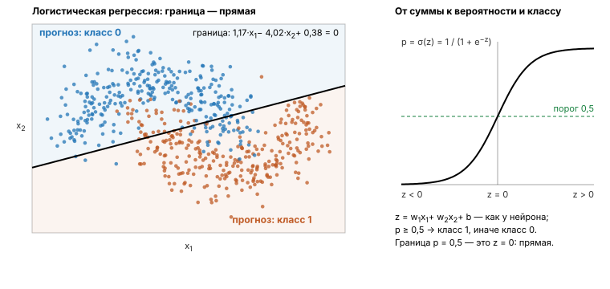

## Зачем это нужно

До сих пор модели предсказывали число — цену. Во многих задачах ответ — **класс**: письмо — спам или нет, операция — мошенническая или нет, у пациента болезнь есть или нет. Если классов два, задачу называют **бинарной классификацией**, а классы обозначают 0 и 1.

Чтобы было что нарисовать, возьмём искусственные данные из ноутбука курса — «два полумесяца». У точки две координаты, x₁ и x₂, а класс — номер полумесяца. Координаты зашумлены: часть точек разных классов перемешана. Граница между полумесяцами изогнута, и мы увидим, какие модели умеют её повторить.

## Данные

```python
print('Точек: train', len(X_train), '| validation', len(X_valid), '| test', len(X_test))
print('Доля класса 1:', y_train.mean(), y_valid.mean(), y_test.mean())
plt.figure(figsize=(6, 4))
plt.scatter(X_train['x1'], X_train['x2'], c=y_train, cmap='coolwarm', s=14)
plt.xlabel('x1')
plt.ylabel('x2')
plt.title('Обучающая выборка: 600 точек')
plt.axis('equal')
plt.show()
```

Разбиение 600 / 200 / 200 — как в ноутбуке. Параметр `stratify=y` в `train_test_split` сохраняет доли классов в каждой части: везде ровно половина точек класса 1.

## Логистическая регрессия: нейрон с сигмоидой

**Логистическая регрессия** — один нейрон из урока 8.1 с сигмоидой на выходе. Она считает взвешенную сумму z = w₁x₁ + w₂x₂ + b, а сигмоида превращает её в **вероятность класса 1**: p = σ(z), от 0 до 1. Класс выбирают по **порогу** 0,5: p ≥ 0,5 → класс 1.

```python
logreg = LogisticRegression().fit(X_train, y_train)
proba = logreg.predict_proba(X_valid)[:, 1]          # вероятность класса 1
pred = logreg.predict(X_valid)                       # класс по порогу 0,5
print(pd.DataFrame({'x1': X_valid['x1'], 'x2': X_valid['x2'], 'вероятность 1': proba.round(3),
                    'прогноз': pred, 'класс': y_valid}).head())
print('Прогноз = (вероятность ≥ 0,5):', np.array_equal(pred, (proba >= 0.5).astype(int)))
print('Доля верных ответов (accuracy):', accuracy_score(y_valid, pred))
print('Веса:', logreg.coef_.round(2), '| смещение:', logreg.intercept_.round(2))
```

`predict_proba` возвращает таблицу из двух столбцов: вероятности классов 0 и 1, в сумме 1. Берём второй. **Доля верных ответов** (accuracy) — простейшая метрика классификации: `(pred == y).mean()`. У логистической регрессии она 0,855 на validation.

Учится логистическая регрессия на **логистической потере** (log loss, бинарная кросс-энтропия):

$$
L = -\frac{1}{n}\sum_i \bigl(y_i \ln p_i + (1 - y_i)\ln(1 - p_i)\bigr)
$$

Для точки класса 1 штраф — −ln p: при p = 0,99 он 0,01, при p = 0,5 — 0,69, а при уверенной ошибке p = 0,01 — 4,6. Так потеря наказывает не только ошибку, но и **уверенность** в ней. MSE тут не подходит: она слабо штрафует уверенные ошибки, а с сигмоидой градиенты MSE в насыщении почти исчезают (урок 8.1).



Класс меняется там, где p = 0,5, то есть z = 0: 1,17·x₁ − 4,02·x₂ + 0,38 = 0. Это прямая. Такую линию на плоскости признаков, где модель меняет ответ, называют **границей решений**. Прямая не может обогнуть загнутые концы полумесяцев, поэтому логистическая регрессия ошибается на каждой седьмой точке.

## Сеть: та же сигмоида на выходе

`MLPClassifier` устроен как `MLPRegressor`, только на выходе — сигмоида и логистическая потеря. Сравним, как в ноутбуке, сети 2 → 16 → 8 → 1 без нелинейности и с ReLU:

```python
nets = {}
for act in ['identity', 'relu']:
    nets[act] = MLPClassifier(hidden_layer_sizes=(16, 8), activation=act, learning_rate_init=0.01,
                              max_iter=500, random_state=42).fit(X_train, y_train)
    p = nets[act].predict_proba(X_valid)[:, 1]
    print(f'{act:8}: эпох {nets[act].n_iter_:3} | accuracy train {accuracy_score(y_train, nets[act].predict(X_train)):.3f}, '
          f'validation {accuracy_score(y_valid, nets[act].predict(X_valid)):.3f} | log loss {log_loss(y_valid, p):.3f}')
```

Без нелинейности сеть — 0,86 на validation и log loss 0,316, ровно как у логистической регрессии. Вся сеть до сигмоиды сводится к a·x₁ + b·x₂ + c (урок 8.2), а значит, граница снова прямая. С ReLU — 0,93 и log loss 0,213: сеть научилась огибать полумесяцы. Обе сети остановились сами (33 и 166 эпох): потери на train перестали улучшаться.

## Граница решений

Границу рисуют так: покрывают плоскость сеткой точек, предсказывают класс в каждой и закрашивают области.

```python
x1 = np.linspace(X_train['x1'].min() - 0.25, X_train['x1'].max() + 0.25, 150)
x2 = np.linspace(X_train['x2'].min() - 0.25, X_train['x2'].max() + 0.25, 150)
xx, yy = np.meshgrid(x1, x2)
grid = pd.DataFrame({'x1': xx.ravel(), 'x2': yy.ravel()})     # 22 500 точек плоскости

def plot_boundary(ax, model, X_show, y_show, title):
    region = model.predict(grid).reshape(xx.shape)
    ax.contourf(xx, yy, region, levels=[-0.5, 0.5, 1.5], colors=['#2375b7', '#c05b26'], alpha=0.18)
    ax.contour(xx, yy, region, levels=[0.5], colors='#444444', linewidths=0.9)
    ax.scatter(X_show['x1'], X_show['x2'], c=y_show, cmap='coolwarm', s=14)
    wrong = model.predict(X_show) != y_show
    ax.scatter(X_show['x1'][wrong], X_show['x2'][wrong], marker='x', color='black', s=30)
    ax.set_title(f'{title} · {accuracy_score(y_show, model.predict(X_show)):.1%}')

fig, axes = plt.subplots(1, 3, figsize=(13, 4), sharey=True)
for ax, (name, model) in zip(axes, [('Логистическая регрессия', logreg), ('MLP: identity', nets['identity']),
                                    ('MLP: relu', nets['relu'])]):
    plot_boundary(ax, model, X_valid, y_valid, name)
plt.tight_layout()
plt.show()
```

Цвет точки — настоящий класс, цвет фона — прогноз, крестик — ошибка. У логистической регрессии и сети без активации граница — почти одна и та же прямая. У сети с ReLU — ломаная кривая из отрезков: каждый нейрон ReLU добавляет излом, и вместе они повторяют изгиб полумесяцев.

## Другие модели — другие границы

```python
others = {'Дерево, глубина 5': DecisionTreeClassifier(max_depth=5, random_state=42),
          'Случайный лес': RandomForestClassifier(n_estimators=60, random_state=42),
          'kNN, k=15': KNeighborsClassifier(n_neighbors=15)}
fig, axes = plt.subplots(1, 3, figsize=(13, 4), sharey=True)
for ax, (name, model) in zip(axes, others.items()):
    model.fit(X_train, y_train)
    plot_boundary(ax, model, X_valid, y_valid, name)
plt.tight_layout()
plt.show()

models = {'Логистическая регрессия': logreg, 'MLP: identity': nets['identity'], 'MLP: relu': nets['relu'], **others}
print(pd.DataFrame({'validation': {n: accuracy_score(y_valid, m.predict(X_valid)) for n, m in models.items()},
                    'test': {n: accuracy_score(y_test, m.predict(X_test)) for n, m in models.items()}}))
```

Дерево делит плоскость порогами по одной координате за раз, поэтому его граница — ступеньки вдоль осей. Лес голосует 60 деревьями, и ступеньки сглаживаются. kNN отдаёт точке класс большинства из 15 соседей — граница гладкая и следует за данными. На test все нелинейные модели близки: 0,935–0,95 против 0,875 у прямых границ.

## Сколько соседей: от извилистой границы к прямой

У kNN один главный гиперпараметр — число соседей. Сравним k = 1, 15 и 301 по **доле ошибок** (1 − accuracy) на train и validation:

```python
fig, axes = plt.subplots(1, 3, figsize=(13, 4), sharey=True)
for ax, k in zip(axes, [1, 15, 301]):
    knn = KNeighborsClassifier(n_neighbors=k).fit(X_train, y_train)
    err_train = 1 - accuracy_score(y_train, knn.predict(X_train))
    err_valid = 1 - accuracy_score(y_valid, knn.predict(X_valid))
    plot_boundary(ax, knn, X_valid, y_valid, f'k={k}: ошибок train {err_train:.1%}, validation {err_valid:.1%}')
    ax.title.set_fontsize(10)
plt.tight_layout()
plt.show()
```

- **k = 1**: на train ни одной ошибки — каждая точка сама себе ближайший сосед. Но граница огибает каждую зашумлённую точку, вокруг отдельных точек появляются «островки», и на validation ошибок 9,5 % — **переобучение**;
- **k = 15**: граница гладкая, ошибок 5,2 % на train и 8 % на validation;
- **k = 301**: в голосование попадает половина train, даже далёкие точки другого полумесяца. Граница становится почти прямой, и загнутые концы полумесяцев теряются: 17 % ошибок на validation — **недообучение**.

Та же картина, что с глубиной дерева (урок 6.5) и числом эпох (урок 8.5). Слишком гибкая граница подстраивается под шум, слишком жёсткая не может повторить настоящую форму. Нужную гибкость выбирают по validation.

## Типичные ошибки

:::mistake Брать `predict_proba` целиком
`predict_proba` возвращает два столбца — вероятности классов 0 и 1. Вероятность класса 1 — `[:, 1]`.
:::

:::mistake Ждать от сети без активации изогнутой границы
`activation='identity'` даёт прямую границу, сколько бы ни было слоёв: до сигмоиды сеть — одна взвешенная сумма.
:::

:::mistake Судить по accuracy на train
У kNN с k = 1 на train 100 % верных ответов, а на validation он хуже, чем с k = 15. Как и в регрессии, модель выбирают по validation.
:::

:::mistake Учить классификатор на MSE
Для вероятностей подходит логистическая потеря: она сильно штрафует уверенные ошибки. В `LogisticRegression` и `MLPClassifier` она стоит по умолчанию.
:::

## Мини-квиз

```quiz
- q: Модель выдала вероятность класса 1, равную 0,7. Какой класс она предскажет при пороге 0,5?
  options:
    - Класс 1
    - Класс 0
    - Ни один — нужна вероятность ровно 1
  answer: 0
  explain: p ≥ 0,5 → класс 1. Порог можно сдвигать, если ошибки разного рода стоят по-разному.
- q: Почему граница логистической регрессии — прямая?
  options:
    - Класс меняется при p = 0,5, то есть при z = w₁x₁ + w₂x₂ + b = 0 — это уравнение прямой
    - Так устроены данные
    - Потому что она обучается градиентным спуском
  answer: 0
  explain: Сигмоида равна 0,5 при нулевой сумме. Изогнуть границу может только нелинейность внутри модели.
- q: У kNN с k = 1 доля ошибок на train — 0 %, на validation — 9,5 %. Что это?
  options:
    - Переобучение — граница огибает каждую зашумлённую точку
    - Недообучение
    - Идеальная модель
  answer: 0
  explain: При проверке на train каждая точка — сама себе ближайший сосед.
- q: Какая потеря у LogisticRegression и MLPClassifier?
  options:
    - Логистическая (log loss) — она сильно штрафует уверенные ошибки
    - MSE
    - MAE
  answer: 0
  explain: Прогноз 0,5 для любой точки даёт log loss ln 2 ≈ 0,69; уверенная ошибка с p = 0,01 стоит 4,6.
```

## Что запомнить

- Бинарная классификация: ответ — класс 0 или 1. Модель выдаёт вероятность класса 1 (`predict_proba(X)[:, 1]`), класс — по порогу 0,5 (`predict`). Простейшая метрика — accuracy, доля верных ответов.
- Логистическая регрессия — нейрон с сигмоидой; учится на логистической потере. Её граница решений — прямая.
- `MLPClassifier` — сеть с сигмоидой на выходе. С ReLU она гнёт границу: 0,93 против 0,86 на validation. Без нелинейности граница остаётся прямой.
- Граница решений показывает характер модели: прямая у линейных, ломаная у сети, ступеньки у дерева, гладкая у kNN. Слишком извилистая граница (kNN с k = 1) — переобучение, слишком прямая (k = 301) — недообучение.
