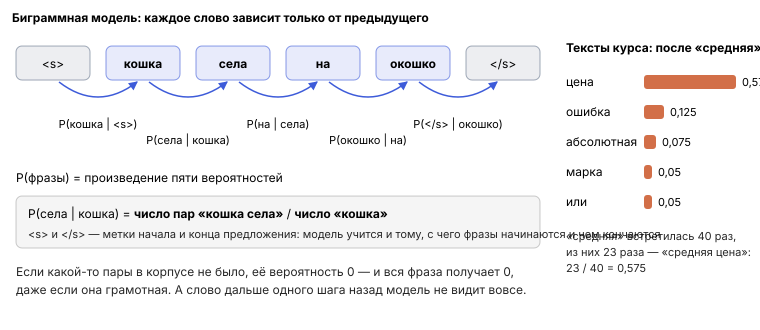

## Зачем это нужно

ChatGPT, GigaChat, YandexGPT — **языковые модели**. Название звучит загадочно, а определение из лекции простое: языковая модель — это распределение вероятностей по последовательностям слов. Для любой фразы она может сказать, насколько та вероятна. Отсюда два умения:

- **продолжить** фразу: «Кошка села на …» — какое слово вероятнее всего следующее;
- **заполнить пропуск**: «Одеяло [MASK], простыня улетела» → «убежало» (вероятность около 0,98), «сбежало» (0,015), «исчезло» (0,005) — пример из лекции.

Учится языковая модель на **корпусе текстов** — всех книгах Пушкина, Википедии, новостях — и без ручной разметки: правильный ответ (следующее слово) содержится в самом тексте. Начнём с самой простой модели, которая просто считает, и построим её на текстах этого курса.

## Корпус и пары слов

Корпус уже разбит на предложения `sents`, каждое — список слов. Будем считать **биграммы** — пары соседних слов. В начало и конец предложения добавим метки `<s>` и `</s>`: модель должна знать, с каких слов фразы начинаются и какими заканчиваются.

```python
bigrams = Counter()
for s in sents:
    seq = ['<s>'] + s + ['</s>']
    bigrams.update(zip(seq, seq[1:]))          # пары соседних слов
print('Предложений:', len(sents), '| слов:', sum(len(s) for s in sents), '| разных пар:', len(bigrams))
print(bigrams.most_common(6))
print('«средняя цена»:', bigrams[('средняя', 'цена')], 'раз')
```

`Counter` — словарь-счётчик из стандартной библиотеки Python: `update` прибавляет по единице за каждый элемент, а `most_common` выдаёт самые частые. Чаще всего предложения начинаются словом «в» (152 раза), а самая частая пара внутри предложения — «а не» (124). Пара «средняя цена» встретилась 23 раза.

## Вероятность следующего слова



Биграммная модель отвечает на вопрос «какое слово идёт после этого?» долей пар: из 40 раз, что встретилось «средняя», 23 раза за ним шло «цена».

$$
P(\text{цена} \mid \text{средняя}) = \frac{\text{число пар «средняя цена»}}{\text{число пар, начинающихся со «средняя»}} = \frac{23}{40} = 0{,}575
$$

```python
first = Counter()                               # сколько пар начинается с каждого слова
for (a, b), c in bigrams.items():
    first[a] += c

def next_words(word, k=4):
    options = [(b, c / first[word]) for (a, b), c in bigrams.items() if a == word]
    return sorted(options, key=lambda x: -x[1])[:k]

for w in ['обучающей', 'градиентный', 'линейная', 'кросс']:
    print(w, '→', [(b, round(p, 3)) for b, p in next_words(w)])
```

После «обучающей» в 92 % случаев идёт «части», после «градиентный» — «спуск» (0,67) или «бустинг» (0,22). После «кросс» модель видит четыре разных формы одного слова: «валидация», «валидацией», «валидации», «валидацию». Для неё это разные слова — она ничего не знает о русской грамматике.

## Вероятность фразы

Вероятность фразы — произведение вероятностей её биграмм, от `<s>` до `</s>`:

```python
def phrase_prob(sentence):
    seq = ['<s>'] + words(sentence) + ['</s>']
    p = 1.0
    for a, b in zip(seq, seq[1:]):
        p *= bigrams[(a, b)] / first[a] if first[a] else 0.0
    return p

for s in ['Случайный лес.', 'Средняя цена машин.', 'Градиентный спуск.', 'Линейная регрессия предсказывает цену.']:
    print(f'{s:42} {phrase_prob(s):.2e}')
```

«Случайный лес.» получает 2,5·10⁻⁵, а «Градиентный спуск.» — **ноль**. Пара «градиентный спуск» в корпусе есть, но после слова «спуск» предложение ни разу не заканчивалось. По той же причине ноль у грамотной фразы «Линейная регрессия предсказывает цену.»: пары «регрессия предсказывает» в текстах курса нет. Одна невиданная пара обнуляет всё произведение.

## Генерация текста

Языковая модель умеет писать: выбираем следующее слово случайно, с вероятностями из модели, и повторяем.

```python
rng = np.random.default_rng(7)
for _ in range(3):
    w, out = '<s>', []
    while len(out) < 15:
        options = [(b, c) for (a, b), c in bigrams.items() if a == w]
        probs = np.array([c for _, c in options], dtype=float)
        w = options[rng.choice(len(options), p=probs / probs.sum())][0]
        if w == '</s>':
            break
        out.append(w)
    print(' '.join(out))
```

Получается «единственно верное k 1» и «если критерии очистки модуль для любой моделью». Каждая соседняя пара настоящая, а смысла нет: модель помнит только одно предыдущее слово. Если же всегда брать самое вероятное слово, генерация быстро сворачивает к самым частым оборотам — «в уроке 1».

## Почему подсчётов мало

Проверим модель честно: построим пары по 90 % предложений и посмотрим, какую долю пар оставшихся 10 % она видела.

```python
cut = int(len(sents) * 0.9)
train_pairs = Counter()
for s in sents[:cut]:
    seq = ['<s>'] + s + ['</s>']
    train_pairs.update(zip(seq, seq[1:]))
test_pairs = [p for s in sents[cut:] for p in zip(['<s>'] + s, s + ['</s>'])]
unseen = sum(p not in train_pairs for p in test_pairs) / len(test_pairs)
print(f'Пар в новых предложениях: {len(test_pairs)}, из них не встречалось: {unseen:.1%}')
```

**68 %** пар из новых предложений модель не встречала ни разу — для неё у таких фраз вероятность ноль. Учесть более длинный контекст (три, четыре слова — n-граммы) ещё хуже: длинные сочетания повторяются ещё реже. Корпус в миллиарды слов помогает, но не решает проблему.

Нейросетевые языковые модели обходят её двумя идеями. Похожие слова получают похожие векторы — урок 9.2. Тогда «спуск» и «бустинг» близки, а невиданная пара не обязательно невероятна. А механизм **внимания** позволяет учитывать весь предыдущий текст, а не одно слово — урок 9.3.

## Типичные ошибки

:::mistake Забыть метки начала и конца
Без `<s>` и `</s>` модель не знает, какими словами начинаются и заканчиваются предложения. Вероятность фразы тогда не учитывает, что после «спуск» точка не встречалась.
:::

:::mistake Делить на число всех слов
P(следующее | текущее) делят на число пар, начинающихся с текущего слова, а не на размер корпуса. Иначе это вероятность пары, а не условная вероятность следующего слова.
:::

:::mistake Считать ноль доказательством ошибки
Вероятность 0 у фразы значит только «таких пар в корпусе не было». «Линейная регрессия предсказывает цену» — грамотная фраза, просто в текстах курса её нет.
:::

## Мини-квиз

```quiz
- q: Что такое языковая модель?
  options:
    - Распределение вероятностей по последовательностям слов — модель оценивает, насколько вероятна фраза
    - Словарь всех слов языка
    - Программа, проверяющая орфографию
  answer: 0
  explain: Из этого вытекают умения продолжать фразу и заполнять пропуски.
- q: «средняя» встретилась 40 раз, из них 23 раза — «средняя цена». Чему равна P(цена | средняя)?
  options:
    - "0,575"
    - "23"
    - "23 / число всех слов корпуса"
  answer: 0
  explain: Условная вероятность — доля пар среди всех пар, начинающихся со «средняя».
- q: Почему у грамотной фразы «Градиентный спуск.» вероятность 0?
  options:
    - В корпусе ни одно предложение не заканчивалось словом «спуск» — пары (спуск, </s>) нет
    - Фраза слишком короткая
    - Модель не знает слова «градиентный»
  answer: 0
  explain: Одна невиданная пара обнуляет произведение. Это главная слабость подсчётов.
- q: Какую долю пар новых предложений биграммная модель не встречала?
  options:
    - Около двух третей
    - Около 5 %
    - Ни одной — модель видела все пары
  answer: 0
  explain: 68 % — поэтому подсчёты заменили нейросети, которые обобщают на похожие слова.
```

## Что запомнить

- Языковая модель — распределение вероятностей по последовательностям слов: она продолжает фразы и заполняет пропуски. Учится на корпусе текстов без ручной разметки.
- Биграммная модель: P(следующее | текущее) = число пар / число пар, начинающихся с текущего слова. Вероятность фразы — произведение по всем парам, с метками `<s>` и `</s>`.
- Генерация — выбор следующего слова по этим вероятностям. Биграммы помнят одно слово назад, поэтому текст выходит бессвязным.
- Слабость подсчётов — нули: 68 % пар новых предложений модель не видела. Нейросети решают это векторами слов и механизмом внимания (уроки 9.2–9.3).
