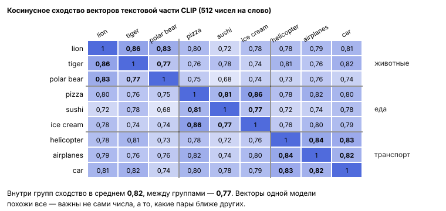

## Зачем это нужно

Биграммная модель из урока 9.1 считает «спуск» и «бустинг» просто разными строками и ничего не знает об их сходстве. Нейросети поступают иначе: каждому слову сопоставляют **вектор** из сотен чисел — **эмбеддинг**. Векторы подбирают так, чтобы близкие по смыслу слова оказались рядом. Тогда модель, видевшая «линейная регрессия предсказывает цену», догадается, что «линейная модель предсказывает цену» тоже вероятна.

Эмбеддинги бывают у слов, фраз, картинок, звука — у всего, с чем работают современные модели. Чтобы с ними работать, нужно уметь измерять, насколько два вектора похожи.

## Косинусное сходство

Похожесть векторов измеряют углом между ними: чем меньше угол, тем больше косинус.

$$
\cos(a, b) = \frac{a \cdot b}{\lvert a\rvert \, \lvert b\rvert}
$$

```python
def cosine(a, b):
    return a @ b / (np.sqrt(a @ a) * np.sqrt(b @ b))

a = np.array([3.0, 4.0])
print('Тот же вектор, но длиннее:', cosine(a, np.array([6.0, 8.0])))
print('Перпендикулярный:', cosine(a, np.array([4.0, -3.0])))
print('Противоположный:', cosine(a, np.array([-3.0, -4.0])))
```

Косинус равен 1 для векторов одного направления — неважно, какой они длины, — 0 для перпендикулярных и −1 для противоположных. Если заранее разделить векторы на их длину (урок 9.0), косинус превращается в обычное скалярное произведение. Поэтому эмбеддинги почти всегда хранят нормированными: сходство одного вектора со всеми сразу — это одно умножение матрицы на вектор.

## Слово определяется соседями

Откуда взять векторы? Старая идея лингвистов: смысл слова — в его окружении. Слова, которые встречаются рядом с одними и теми же словами, похожи по смыслу. Опишем каждое слово тем, сколько раз рядом с ним встречалось каждое другое — это уже вектор:

```python
counts = Counter(w for s in sents for w in s)
stop = {w for w, _ in counts.most_common(60)}             # самые частые служебные слова не помогают
vocab = [w for w, c in counts.most_common() if w not in stop and len(w) > 2][:800]
index = {w: i for i, w in enumerate(vocab)}
M = np.zeros((len(vocab), len(vocab)))
for s in sents:
    ids = [index.get(w) for w in s]
    for i, a in enumerate(ids):
        if a is None:
            continue
        for b in ids[max(0, i - 3):i] + ids[i + 1:i + 4]:   # соседи в окне ±3 слова
            if b is not None:
                M[a, b] += 1

M_unit = M / np.linalg.norm(M, axis=1, keepdims=True)        # строки длины 1
for w in ['пробег', 'нейрон', 'регрессия']:
    sims = M_unit @ M_unit[index[w]]                          # косинус со всеми словами сразу
    print(w, '→', [vocab[j] for j in np.argsort(-sims)[1:6]])
```

`np.linalg.norm` считает длину вектора, `axis=1` — для каждой строки. Без всякой нейросети «пробег» оказался рядом с «двигателя» и «объём» — в курсе они встречаются вместе в описании машин. А «нейрон» — рядом с «линейная» и «регрессия». Ту же идею в 2013 году использовала модель word2vec — только векторы она подбирала нейросетью на миллиардах слов.

## Векторы настоящей модели

Модель CLIP, с которой мы будем классифицировать картинки (урок 9.7), переводит любую подпись в вектор из 512 чисел. В файле урока — векторы английских названий 349 классов картинок соревнования:

```python
name_unit = name_vecs / np.linalg.norm(name_vecs, axis=1, keepdims=True)
for w in ['pizza', 'helicopter', 'sushi']:
    sims = name_unit @ name_unit[names.index(w)]
    best = np.argsort(-sims)[1:6]
    print(f'{w:11}', [(names[j], round(float(sims[j]), 2)) for j in best])
```

Для «pizza» ближайшие — «steak», «pancakes», «ice cream», для «helicopter» — «airplanes», «car» и «motorbike», для «sushi» — «sashimi». Модель училась на сотнях миллионов подписей к картинкам и разложила слова по смыслу без нашей помощи.



Обратите внимание на сами числа: даже у «lion» и «pizza» сходство 0,80. Векторы одной модели похожи все, и абсолютное значение мало что значит. Важно, какие пары **ближе других**:

```python
groups = {'животные': ['lion', 'tiger', 'polar bear'], 'еда': ['pizza', 'sushi', 'ice cream'],
          'транспорт': ['helicopter', 'airplanes', 'car']}
flat = [w for ws in groups.values() for w in ws]
V = name_unit[[names.index(w) for w in flat]]
S = V @ V.T                                                 # 9 × 9 косинусов
same = np.array([[i // 3 == j // 3 and i != j for j in range(9)] for i in range(9)])
other = np.array([[i // 3 != j // 3 for j in range(9)] for i in range(9)])
print('Сходство внутри групп:', S[same].mean().round(3), '| между группами:', S[other].mean().round(3))
```

## Типичные ошибки

:::mistake Сравнивать скалярное произведение ненормированных векторов
`a @ b` растёт с длиной векторов: частое слово с длинным вектором окажется «похожим» на всё. Сначала нормируйте или делите на произведение длин — тогда это косинус.
:::

:::mistake Читать косинус как вероятность
Сходство 0,8 не значит «похоже на 80 %». У CLIP почти все пары слов дают 0,7–0,9. Смотрите, какие пары ближе других, а не на само число.
:::

:::mistake Сравнивать векторы разных моделей
Векторы двух моделей живут в разных пространствах: у каждой свои координаты. Сравнивают только векторы одной модели — как картинку и подпись в одной CLIP.
:::

## Мини-квиз

```quiz
- q: Чему равно косинусное сходство векторов [1, 2] и [2, 4]?
  options:
    - "1 — у них одно направление"
    - "0,5 — второй вдвое длиннее"
    - "2"
  answer: 0
  explain: Косинус не зависит от длины векторов, только от угла между ними.
- q: Зачем эмбеддинги нормируют к длине 1?
  options:
    - Тогда косинус — это просто скалярное произведение, и сходство со всеми считается одним умножением матрицы
    - Так векторы занимают меньше памяти
    - Иначе нельзя посчитать среднее
  answer: 0
  explain: name_unit @ вектор — сразу 349 косинусов.
- q: На чём основана идея «слово определяется соседями»?
  options:
    - Слова, встречающиеся рядом с одними и теми же словами, похожи по смыслу
    - Похожие слова пишутся похожими буквами
    - Частые слова важнее редких
  answer: 0
  explain: Так в курсе «пробег» оказался рядом с «объём» и «двигателя».
- q: У «lion» и «pizza» сходство векторов CLIP 0,80. Что из этого следует?
  options:
    - Почти ничего — у этой модели почти все пары дают 0,7–0,9; важно, что «lion» и «tiger» ближе
    - Лев и пицца похожи на 80 %
    - Модель ошиблась
  answer: 0
  explain: Сравнивают сходства между собой, а не с нулём.
```

## Что запомнить

- Эмбеддинг — вектор из сотен чисел вместо слова, фразы или картинки. Близкие по смыслу объекты получают близкие векторы.
- Косинусное сходство — a·b / (|a|·|b|): 1 — одно направление, 0 — перпендикулярны. Для нормированных векторов это скалярное произведение, со всеми сразу — умножение матрицы на вектор.
- Векторы можно построить по соседству слов в текстах («слово определяется соседями») или взять у нейросети. Векторы CLIP знают, что «pizza» ближе к «steak», чем к «helicopter».
- Сходства внутри одной модели сравнивают между собой: у CLIP почти все пары дают 0,7–0,9.
