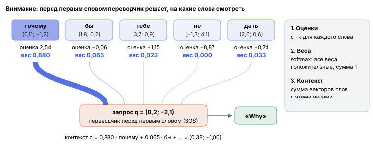
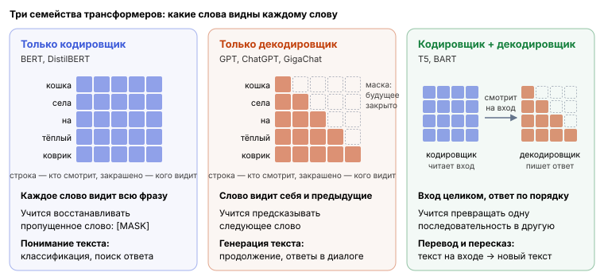

## Зачем это нужно

Биграммная модель из урока 9.1 помнит одно предыдущее слово. Рекуррентные сети, которыми переводили тексты до 2017 года, читают фразу слово за словом и держат в памяти одно состояние — вектор фиксированной длины. На лекции об этом говорили так: к концу длинной фразы начало в такой памяти «затухает», в один вектор не помещается всё, что нужно для перевода.

Решение придумали для машинного перевода. На каждом шаге модель заново смотрит на **все** слова исходной фразы и сама решает, какие из них важны прямо сейчас. Это **механизм внимания**. В 2017 году вышла статья «Attention Is All You Need» («Внимание — всё, что нужно»). В ней предложили сеть только из блоков внимания — **трансформер**. На трансформерах построены BERT, GPT, ChatGPT, GigaChat и модель CLIP из урока 9.2.

## Внимание: на что смотреть сейчас

Пример из лекции — фраза из набора переводов OPUS 100: «Почему бы тебе не дать нам немного времени обсудить…» → «Why don't you let us talk about it…». Кодировщик превратил каждое русское слово в вектор: в лекции — из двух чисел, в настоящих моделях — из сотен. Переводчик собирается написать первое английское слово, его состояние — вектор **запроса** `q`. Внимание работает в три шага:

1. **Оценки.** Скалярное произведение запроса с вектором каждого слова: чем оно больше, тем лучше слово подходит запросу.
2. **Веса.** Функция softmax превращает оценки в положительные веса с суммой 1 (подробно — в следующем шаге урока).
3. **Контекст.** Взвешенная сумма векторов слов — то, что переводчик «увидел».

$$
s_i = q \cdot k_i, \qquad a_i = \frac{e^{s_i}}{\sum_j e^{s_j}}, \qquad c = \sum_i a_i\, k_i
$$

```python
def softmax(s):
    e = np.exp(s - s.max(axis=-1, keepdims=True))     # вычитаем максимум, чтобы exp не переполнилась
    return e / e.sum(axis=-1, keepdims=True)

words = ['почему', 'бы', 'тебе', 'не', 'дать']
K = np.array([[0.11, -1.2], [1.8, 0.2], [3.7, 0.9], [-1.3, 4.1], [2.6, 0.6]])   # векторы слов
q = np.array([0.2, -2.1])                     # запрос: переводчик перед первым словом
scores = K @ q                                # оценки — скалярные произведения
weights = softmax(scores)
for w, s, a in zip(words, scores, weights):
    print(f'{w:7} оценка {s:6.2f}   вес {a:.3f}')
print('Контекст:', (weights @ K).round(3))
```

88 % внимания достаётся слову «почему» — переводчик напишет «Why». Остальные слова почти не участвуют. У «не» оценка −8,87, и его вес меньше тысячной.



## Softmax

$$
\mathrm{softmax}(s)_i = \frac{e^{s_i}}{\sum_j e^{s_j}}
$$

Экспонента делает все веса положительными, деление на сумму даёт в сумме 1. Чем больше оценка, тем больше вес, причём разница усиливается. Оценки «почему» и «бы» (2,54 и −0,06) различаются на 2,6, а их веса — в 13,5 раза: e^2,6 ≈ 13,5.

```python
print(softmax(np.array([0.0, 1.0, 2.0])).round(3))
print(softmax(np.array([1000.0, 1001.0, 1002.0])).round(3))   # тот же ответ: важны только разности оценок
```

Если ко всем оценкам прибавить одно и то же число, веса не изменятся: общий множитель e^m сокращается при делении. Поэтому в функции из оценок вычитают максимум — без этого `np.exp(1000)` даёт бесконечность, а веса превращаются в `nan`. Softmax — обобщение сигмоиды из урока 8.7 на любое число вариантов. Им же модели превращают оценки в вероятности классов (урок 9.6).

## Самовнимание: каждое слово смотрит на все

Слова нужно согласовывать и внутри самой фразы. «Почему бы тебе не дать нам немного…» — дальше «время», «времени» или «времена»? Чтобы выбрать «времени», модель должна посмотреть на «немного». В **самовнимании** каждое слово фразы задаёт свой запрос и само служит ответом на запросы других. Из вектора слова x получают три вектора с помощью трёх матриц, которые подбирает обучение:

- запрос q = x·W_Q — что слово ищет;
- ключ k = x·W_K — по чему его находят другие слова;
- значение v = x·W_V — что оно передаёт тем, кто на него смотрит.

Для всех слов сразу — одна формула из матриц:

$$
\mathrm{Attention}(Q, K, V) = \mathrm{softmax}\!\left(\frac{Q K^{\top}}{\sqrt{d}}\right) V
$$

```python
rng = np.random.default_rng(0)
sentence = ['кошка', 'села', 'на', 'тёплый', 'коврик']
d = 4
X = rng.normal(size=(5, d))                               # векторы слов (в модели — эмбеддинги)
Wq, Wk, Wv = (rng.normal(size=(d, d)) for _ in range(3))  # в модели их подбирает обучение
Q, K, V = X @ Wq, X @ Wk, X @ Wv
scores = Q @ K.T / np.sqrt(d)                             # 5 × 5: оценка для каждой пары слов
A = softmax(scores)                                       # softmax каждой строки
print(np.round(A, 2))
print('Суммы строк:', A.sum(axis=1).round(6))
out = A @ V                                               # новые векторы слов
print('Выход:', out.shape)
```

Строка i матрицы `A` — веса внимания слова i ко всем словам фразы, их сумма 1. Выход — новые векторы слов: каждый — смесь векторов-значений тех слов, на которые слово смотрит. Матрицы W здесь случайные, поэтому и картина внимания случайна. Обучение подбирает их так, чтобы, например, «тёплый» смотрело на «коврик».

Зачем делить на √d? Скалярное произведение векторов растёт вместе с их длиной d. При больших оценках softmax отдаёт почти весь вес одному слову, внимание перестаёт смешивать информацию, и обучение замедляется. Деление на √d возвращает оценки к привычному масштабу. У головы DistilBERT d = 64, и оценки делят на 8.

## Маска: GPT не подглядывает

Модели GPT учатся предсказывать следующее слово (урок 9.1). Если слово видит слова справа от себя, задача решается подглядыванием. Поэтому в декодировщике оценки «будущих» слов перед softmax заменяют на −∞: e^−∞ = 0, и вес будущего — ровно ноль.

```python
future = np.triu(np.ones((5, 5), dtype=bool), k=1)    # True над диагональю — слова правее
A_causal = softmax(np.where(future, -np.inf, scores))
print(np.round(A_causal, 2))
out_causal = A_causal @ V
print('Выход первого слова — его собственное значение:', np.allclose(out_causal[0], V[0]))
print('Выход последнего слова не изменился:', np.allclose(out_causal[-1], out[-1]))
```

`np.triu(..., k=1)` выделяет верхний треугольник матрицы без диагонали. Первое слово видит только себя (вес 1), второе — два первых слова, последнее — всю фразу, поэтому его выход тот же, что без маски. Маску ставят до softmax: если обнулить веса после него, строки перестанут давать в сумме 1.

## Трансформер

Трансформер — стопка одинаковых блоков. В каждом блоке два слоя:

- **многоголовое внимание** (multi-head attention): несколько голов работают параллельно, у каждой свои матрицы W_Q, W_K и W_V. На слайде лекции: «каждый блок выделяет информацию, полезную для разных задач»;
- **полносвязная сеть** — MLP из урока 8.2, отдельно для вектора каждого слова.

Сами по себе внимание и MLP не знают порядка слов: если переставить слова, строки выхода просто переставятся. Поэтому к вектору каждого токена прибавляют вектор его позиции во фразе. У DistilBERT 6 блоков по 12 голов, векторы из 768 чисел и 66 млн параметров. У GPT-3 — 96 блоков и 175 млрд параметров. **Большая** языковая модель — это миллиарды параметров, корпус размером с интернет и тысячи видеокарт для обучения.



- **Только кодировщик** (BERT, DistilBERT). Каждое слово видит всю фразу. Учится заполнять пропуски — «Одеяло [MASK], простыня улетела» (урок 9.1). Подходит для понимания текста: классификации тональности, поиска ответа в тексте. С DistilBERT мы будем работать в уроках 9.4–9.6.
- **Только декодировщик** (GPT, ChatGPT, GigaChat). Маска: слово видит себя и предыдущие слова. Учится предсказывать следующее слово и поэтому умеет писать текст.
- **Кодировщик и декодировщик** (T5, BART). Кодировщик читает вход целиком, декодировщик пишет ответ по порядку и через внимание смотрит на вход — как переводчик из примера выше. Подходит для перевода и пересказа.

## Что видят головы настоящей модели

Посмотрим на настоящие веса внимания модели DistilBERT — той, что в уроке 9.4 будет оценивать тональность отзывов. Мы один раз прогнали через неё фразу и сохранили веса всех 6 × 12 = 72 голов. Перед текстом модель ставит служебный токен [CLS], в конце — [SEP] (урок 9.5).

```python
with np.load('distilbert_attention.npz') as data:
    tokens = [str(t) for t in data['tokens']]
    attn = data['attn']                                   # слой × голова × токен × токен
print(attn.shape, ' '.join(tokens))
for layer, head in [(2, 10), (5, 10), (3, 4)]:
    A = attn[layer - 1, head - 1]                         # 16 × 16, каждая строка в сумме 1
    target = A.argmax(axis=1)                             # на какой токен каждый смотрит сильнее всего
    pairs = [f'{tokens[i]}→{tokens[j]}' for i, j in enumerate(target) if 0 < i < len(tokens) - 1]
    print(f'Слой {layer}, голова {head}:', ' '.join(pairs))
```

Роли голов никто не задавал — они появились при обучении:

- голова 10 второго слоя у каждого токена сильнее всего смотрит на **следующий** токен;
- голова 10 пятого слоя у всех токенов смотрит на служебный [SEP]. Так ведёт себя голова, которой в этой фразе «нечего искать». Почти целиком на [CLS] или [SEP] смотрят 16 голов из 72;
- голова 4 третьего слоя связывает «first» с «second» (вес 0,95) и одно «half» с другим (0,93). Она заметила параллельную конструкцию «первая половина… вторая половина», а остальные токены у неё смотрят на [SEP].

Во второй фразе одна из голов связывает местоимение со словом, к которому оно относится:

```python
with np.load('distilbert_attention.npz') as data:
    tokens2 = [str(t) for t in data['tokens2']]
    attn2 = data['attn2']
print(' '.join(tokens2))
row = attn2[4 - 1, 6 - 1, tokens2.index('it')]          # слой 4, голова 6: куда смотрит «it»
for j in np.argsort(-row)[:3]:
    print(f'{tokens2[j]:10} {row[j]:.2f}')
```

«it» отдаёт слову «food» 58 % внимания: голова словно выясняет, что именно оказалось «actually delicious». Но веса одной головы — не объяснение решения модели. Ответ складывается из всех 72 голов и 6 слоёв.

## Типичные ошибки

:::mistake Softmax не по той оси
Строка матрицы внимания — веса одного слова, поэтому в сумме 1 должна давать каждая строка: softmax по последней оси (`axis=-1`). Если нормировать столбцы, веса слова перестанут складываться в 1.
:::

:::mistake Забыть деление на √d
Без него оценки растут с длиной векторов, softmax отдаёт почти весь вес одному слову, и внимание перестаёт смешивать информацию.
:::

:::mistake Ставить маску после softmax или ставить 0 вместо −∞
Если обнулить веса будущих слов после softmax, строки перестанут давать в сумме 1. Оценки будущих слов заменяют на −∞ до softmax. Ноль вместо −∞ тоже не годится: e⁰ = 1, и будущее получит вес.
:::

:::mistake Читать веса внимания как объяснение
Вес 0,58 у пары «it → food» показывает, куда смотрит одна голова. Решение модели складывается из всех голов и слоёв, поэтому веса внимания — подсказка, а не доказательство.
:::

## Мини-квиз

```quiz
- q: Что делает механизм внимания при переводе?
  options:
    - На каждом шаге сравнивает запрос со всеми словами исходной фразы и берёт их взвешенную сумму — больше всего от самых подходящих
    - Переводит слова по одному, по словарю
    - Запоминает только последнее прочитанное слово
  answer: 0
  explain: Перед словом «Why» переводчик отдал 88 % внимания слову «почему».
- q: "softmax превратил оценки [2, 1, 0] в веса. Что верно?"
  options:
    - Веса положительные, в сумме дают 1, наибольший — у первой оценки
    - Веса равны 2/3, 1/3 и 0
    - Веса зависят только от наибольшей оценки
  answer: 0
  explain: softmax([2, 1, 0]) ≈ [0,665; 0,245; 0,090].
- q: Зачем в декодировщике GPT маска?
  options:
    - Чтобы слово не видело следующих слов — иначе предсказание следующего слова решалось бы подглядыванием
    - Чтобы ускорить вычисления
    - Чтобы не учитывать служебные токены
  answer: 0
  explain: Оценки будущих слов заменяют на −∞ до softmax, и их вес становится нулём.
- q: Какое семейство трансформеров создано для понимания текста — например, классификации тональности?
  options:
    - Кодировщики, как BERT: каждое слово видит всю фразу
    - Декодировщики, как GPT
    - Только модели «кодировщик + декодировщик»
  answer: 0
  explain: В уроках 9.4–9.6 тональность отзывов оценивает кодировщик DistilBERT.
```

## Что запомнить

- Внимание: оценки q·k для всех слов → softmax → веса с суммой 1 → взвешенная сумма векторов. Модель на каждом шаге сама решает, на какие слова смотреть.
- Самовнимание: каждое слово смотрит на все слова той же фразы. Q, K и V получают умножением векторов слов на обучаемые матрицы, результат — softmax(QKᵀ/√d)·V.
- Маска запрещает смотреть на будущие слова: оценки над диагональю заменяют на −∞ до softmax. Так устроены декодировщики вроде GPT.
- Трансформер — стопка блоков «многоголовое внимание + MLP». Кодировщики (BERT) понимают текст, декодировщики (GPT) пишут текст, кодировщик с декодировщиком (T5) переводят и пересказывают.
