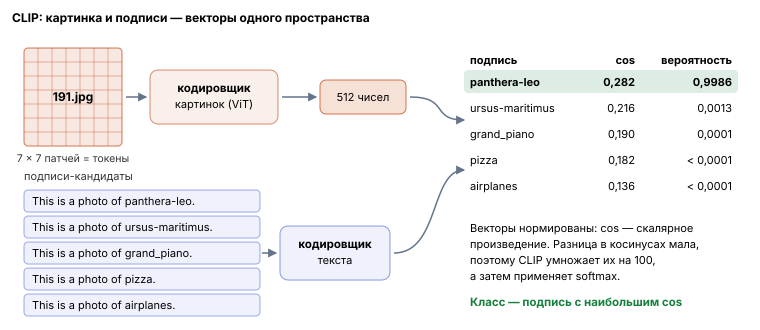

## Зачем это нужно

Обычный классификатор знает только те классы, на которых его учили. Чтобы он начал различать фламинго, нужны сотни размеченных фотографий фламинго и новое обучение.

Модель **CLIP** (OpenAI, 2021) учили по-другому — на 400 миллионах пар «картинка + подпись» из интернета. В ней два трансформера. Один читает текст, как в уроке 9.3. Другой «читает» картинку: её режут на квадраты 32 × 32 пикселя — патчи, и каждый патч становится токеном, как слово во фразе (об этом говорили на лекции). Оба трансформера переводят свой вход в вектор из 512 чисел — в одно общее пространство. Обучение подбирает их так, чтобы картинка и её подпись оказались рядом.

Отсюда приём: классы можно задать одними названиями. Для каждого класса составляем подпись — «This is a photo of …», а класс картинки — подпись с наибольшим сходством. Ни одного размеченного примера не нужно. Это **zero-shot** классификация, классификация «с нуля примеров».



## Картинки соревнования

В соревновании 2 нужно разложить картинки по классам. Мы взяли половину размеченных картинок — 706 штук, по две на класс; вторая половина станет скрытой проверкой соревнования.

```python
import matplotlib.pyplot as plt

images = pd.read_csv('zs_public.csv')
with np.load('zs_thumbs.npz') as data:                  # уменьшенные копии части картинок
    thumb_ids = [str(i) for i in data['ids']]
    thumbs = data['images']
info = images.set_index('ID')
fig, axes = plt.subplots(2, 6, figsize=(10, 4))
for ax, k in zip(axes.ravel(), range(0, 24, 2)):
    ax.imshow(thumbs[k])
    ax.set_title(info.loc[thumb_ids[k], 'class'], fontsize=8)
    ax.axis('off')
plt.show()
print(images.head(3))
print(images['language'].value_counts())
```

Классы названы на трёх языках. По-английски — блюда (группа Dishes) и предметы (Other). На латыни — виды животных: «panthera-leo» — лев, «ursus-maritimus» — белый медведь. И немного классов по-испански: «Elefante», «flamenco». Столбец `english` — наш перевод названий на английский, он понадобится в уроке 9.8.

## Zero-shot одной строкой

```python
from transformers import pipeline

clip = pipeline('zero-shot-image-classification', model='openai/clip-vit-base-patch32')
print(clip('191.jpg', candidate_labels=['panthera-leo', 'ursus-maritimus', 'pizza', 'airplanes', 'grand_piano']))
```

`candidate_labels` — подписи-кандидаты. Pipeline подставляет каждую в шаблон «This is a photo of {}.» и возвращает кандидатов по убыванию вероятности. Картинка 191.jpg — лев, и модель уверена в этом на 99,86 %. Ни одного льва ей для этого не показывали.

:::info CLIP в браузере
Учебная версия CLIP не видит пикселей. Векторы 706 картинок урока и подписей для всех классов один раз посчитала настоящая модель. Картинку передают по ID из `zs_public.csv`, а подписями могут быть названия классов и варианты подписей из урока 9.8. Свои картинки и любые подписи — в Colab.
:::

## Как это устроено

Повторим расчёт pipeline векторами. Векторы картинок лежат в `zs_public.npy` (строки — как в `zs_public.csv`), векторы подписей — в `zs_prompts.npz`:

```python
image_emb = np.load('zs_public.npy').astype(np.float32)          # 706 × 512, строки длины 1
with np.load('zs_prompts.npz') as data:
    is_pipe = data['variant'] == 'pipeline'                       # подписи «This is a photo of {класс}.»
    classes = [str(c) for c in data['class'][is_pipe]]
    text_emb = data['emb'][is_pipe].astype(np.float32)            # 349 × 512
cands = ['panthera-leo', 'ursus-maritimus', 'pizza', 'airplanes', 'grand_piano']
img = image_emb[images.index[images['ID'] == '191.jpg'][0]]
cos = np.array([text_emb[classes.index(c)] @ img for c in cands])   # косинусы: векторы уже нормированы
probs = softmax(100 * cos)
for c, s, p in zip(cands, cos, probs):
    print(f'{c:16} cos {s:.3f}   вероятность {p:.6f}')
```

Все векторы нормированы, поэтому косинусное сходство — просто скалярное произведение (урок 9.2). Косинусы картинки с подписями мало различаются: 0,28 у льва против 0,22 у медведя. Поэтому CLIP умножает их на 100 — обученный множитель, обратный температуре из урока 9.6, — и только потом применяет softmax. Получились ровно числа pipeline.

## Все картинки и все классы

Теперь как в базовом решении соревнования: кандидаты — все 349 классов, для каждой картинки выбираем подпись с наибольшим сходством.

```python
S = image_emb @ text_emb.T                                        # 706 × 349: все косинусы сразу
images['pred'] = np.array(classes)[S.argmax(axis=1)]
images['correct'] = images['pred'] == images['class']
print('Доля верных:', images['correct'].mean().round(3))
print(images.groupby('language')['correct'].agg(['mean', 'size']).round(3))
```

59 % верных ответов на 349 классах без всякого обучения. В ноутбуке соревнования получилось 0,61. На английских названиях модель права в 77 % случаев, на латинских — в 40 %, а из 14 картинок с испанскими названиями не угадала ни одной. CLIP учили на английских подписях из интернета, и латынь и испанский он понимает плохо (урок 9.2).

## Где модель ошибается

```python
errors = images[~images['correct']]
print((errors['class'] + ' → ' + errors['pred']).value_counts().head(8))
```

Посмотрите на пары «настоящий класс → ответ». «flamenco → phoenicopterus-ruber», «cocodrilo → crocodylus-niloticus», «okapia-johnstoni → okapi»: модель узнала животное правильно, но в разметке то же животное встречается под двумя названиями на разных языках. А четыре картинки класса «Faces» модель приняла за колибри «mellisuga-helenae»: подпись «This is a photo of Faces.» для неё мало что значит.

Обе беды лечатся подписями. В уроке 9.8 переведём названия на английский, подберём шаблон и учтём, что группа и язык класса каждой картинки известны.

## Типичные ошибки

:::mistake Писать подписи не на «языке модели»
CLIP учили на английских подписях. Латинские и испанские названия он понимает плохо: на испанских — ни одного верного ответа.
:::

:::mistake Считать вероятности CLIP абсолютными
Softmax распределяет вероятность только между переданными кандидатами. Среди четырёх подписей «Elefante» получает 0,93, а среди всех 349 классов проигрывает. Добавили кандидата — изменились все вероятности.
:::

:::mistake Забыть нормировать векторы
Косинус — скалярное произведение векторов длины 1. Векторы в файлах урока уже нормированы, но свои векторы — например, среднее нескольких подписей — нужно нормировать заново.
:::

:::mistake Не смотреть на разметку
Синонимы на разных языках («flamenco» и «phoenicopterus-ruber») модель различить не может: это одно и то же животное. Прежде чем винить модель, посмотрите, какие ошибки она делает.
:::

## Мини-квиз

```quiz
- q: Что такое zero-shot классификация?
  options:
    - Классификация по одним названиям классов, без размеченных примеров этих классов
    - Классификация с нулевой ошибкой
    - Обучение модели с нуля на своих данных
  answer: 0
  explain: CLIP сравнивает картинку с подписями «This is a photo of …» и выбирает самую похожую.
- q: Как CLIP выбирает класс картинки?
  options:
    - Считает косинусное сходство вектора картинки с векторами подписей и берёт подпись с наибольшим
    - Ищет картинку в интернете и читает подпись к ней
    - Считает долю пикселей каждого цвета
  answer: 0
  explain: Картинка и подписи живут в одном пространстве векторов, близкие по смыслу — рядом.
- q: Зачем CLIP умножает косинусы на 100 перед softmax?
  options:
    - Косинусы мало различаются (0,28 против 0,22), и без множителя softmax дал бы почти равные вероятности
    - Чтобы получить проценты
    - Чтобы косинусы стали положительными
  answer: 0
  explain: softmax([0,28; 0,22]) ≈ [0,51; 0,49], а softmax([28; 22]) ≈ [0,998; 0,002].
- q: Почему на испанских названиях классов CLIP не угадал ни одной картинки?
  options:
    - Его учили на английских подписях, а то же животное есть в разметке под латинским названием — и выигрывает оно
    - Испанских картинок слишком мало для обучения
    - Испанские картинки хуже по качеству
  answer: 0
  explain: «flamenco» проиграл «phoenicopterus-ruber», «cocodrilo» — «crocodylus-niloticus».
```

## Что запомнить

- CLIP переводит картинки и подписи в одно пространство векторов (512 чисел); картинку режут на патчи, и они становятся токенами.
- Zero-shot классификация: класс картинки — подпись с наибольшим косинусным сходством. Вероятности — softmax(100 · cos) по переданным кандидатам.
- Базовое решение соревнования — названия классов в подписях: 59 % верных, но на латыни и испанском модель понимает подписи плохо.
- Смотрите на ошибки: часть из них — синонимы на разных языках и непонятные модели подписи. Их исправляют подписями (урок 9.8).
