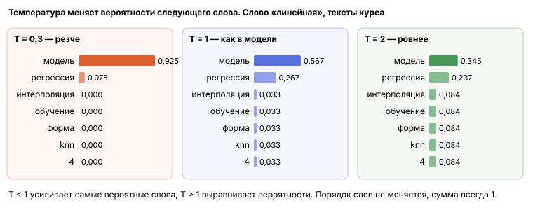

## Зачем это нужно

В уроке 10.1 GigaChat дважды ответил на один и тот же вопрос — и ответы получились разными. Дело не в сбое. Языковая модель пишет ответ **по одному токену**: на каждом шаге она выдаёт вероятности следующего токена и выбирает один из них **случайно**, с этими вероятностями. Так же писал текст генератор из урока 9.1.

Насколько случайно выбирать, задаёт параметр **temperature**. Для теста, где правильный ответ один, случайность вредна. Чтобы придумать десять названий для приложения, она полезна. Разберёмся, что именно делает температура, на биграммной модели из урока 9.1: у неё все вероятности видны.

## Где разошлись ответы

В ноутбуке курса записаны четыре ответа на один и тот же вопрос: два от модели GigaChat и два от GigaChat-2-Pro. Список `records` уже загружен из файла с записанными ответами:

```python
for r in records[:4]:
    print(f"{r['model']:15} {r['response'][:62]}…")
```

Начало у всех четырёх одинаковое — «**Prompt Engineering (». Дальше модель выбирала между «инжиниринг» и «инженерия», потом между «запросов» и «подсказок». Стоило выбрать разные слова, и ответы дальше расходятся полностью: каждый следующий токен зависит от всего, что уже написано. Ответы модели GigaChat совпадают в трёх первых словах, ответы GigaChat-2-Pro — в пяти.

## Следующее слово — по вероятностям

Функция `next_dist(word)` уже готова. Она возвращает слова, которые шли после `word` в текстах курса, и их вероятности, от самого вероятного к редким. Это та же биграммная модель, что в уроке 9.1.

```python
for w in ['градиентный', 'линейная', 'модель']:
    cands, p = next_dist(w)
    print(f'{w} → {len(cands)} вариантов:', ', '.join(f'{c} {x:.3f}' for c, x in zip(cands[:4], p[:4])))

rng = np.random.default_rng(0)
cands, p = next_dist('градиентный')
picks = rng.choice(cands, size=1000, p=p).tolist()     # 1000 раз выбираем следующее слово
print(Counter(picks).most_common())
```

После «градиентный» идёт «спуск» с вероятностью 0,667, «бустинг» — 0,222, конец предложения — 0,111. `rng.choice(..., p=p)` выбирает слово случайно с этими вероятностями. Из 1000 выборов «спуск» выпал 642 раза, «бустинг» — 246, конец — 112: почти 667, 222 и 111, как и обещают вероятности. Чем вероятнее слово, тем чаще его выбирают, но и редкое иногда выпадает.

## Температура



Перед выбором вероятности **перевзвешивают**: каждую возводят в степень 1/T и снова нормируют, чтобы сумма была 1. Число T и есть температура.

$$
q_i = \frac{p_i^{1/T}}{\sum_j p_j^{1/T}}
$$

```python
def with_temperature(p, T):
    q = p ** (1 / T)
    return q / q.sum()

cands, p = next_dist('линейная')
for T in [0.3, 0.5, 1, 2]:
    q = with_temperature(p, T)
    print(f'T = {T}:', ', '.join(f'{c} {x:.3f}' for c, x in zip(cands[:3], q[:3])))
```

- **T = 1** — вероятности модели без изменений: после «линейная» идёт «модель» с вероятностью 0,567, «регрессия» — 0,267.
- **T < 1** — сильные слова становятся сильнее. При T = 0,5 вероятности возводятся в квадрат, и у «модель» уже 0,807. При T = 0,3 — 0,925, а у редких слов почти ноль. Когда T → 0, вся вероятность достаётся самому вероятному слову. Это **жадный выбор**: случайности не остаётся.
- **T > 1** — вероятности выравниваются: при T = 2 у «модель» только 0,345, и редкие слова выпадают заметно чаще.

Порядок слов температура не меняет: самое вероятное слово остаётся самым вероятным. Если у модели есть логиты z, результат тот же, что у softmax(z / T): логиты делят на T и только потом применяют softmax (урок 9.6). Языковые модели так и делают.

## Сколько слов в игре

После предлога «в» в текстах курса встречалось 447 разных слов. Посчитаем, сколько самых вероятных из них набирают 90 % вероятности при разных температурах:

```python
cands, p = next_dist('в')
for T in [0.3, 0.5, 1, 2]:
    q = with_temperature(p, T)
    n90 = int(np.searchsorted(np.cumsum(q), 0.9)) + 1     # сколько первых слов набирают 0,9
    print(f'T = {T}: «{cands[0]}» {q[0]:.3f}, 90 % вероятности — у {n90} слов из {len(cands)}')
```

При T = 0,3 90 % вероятности приходится всего на шесть слов, а у «уроке» — 0,587. При T = 1 те же 90 % размазаны по 329 словам, при T = 2 — по 384. Высокая температура делает ответ разнообразнее, но разнообразие берётся из редких слов.

## Генерация с разной температурой

Соберём генератор из урока 9.1 и добавим ему температуру:

```python
def generate(T, rng, max_len=12):
    w, out = '<s>', []
    while len(out) < max_len:
        cands, p = next_dist(w)
        w = cands[rng.choice(len(cands), p=with_temperature(p, T))]
        if w == '</s>':
            break
        out.append(w)
    return ' '.join(out)

rng = np.random.default_rng(1)
for T in [0.1, 0.7, 1.5]:
    print(f'T = {T}:')
    for _ in range(3):
        print('   ', generate(T, rng))
```

При T = 0,1 генератор трижды пишет одно и то же «в уроке 1» — самые частые слова подряд. При T = 1,5 в текст лезут редкие слова: «автомат 0 или объявления выглядят ли написать…». У настоящей LLM то же самое: при низкой температуре ответ стабильный и предсказуемый, при высокой — разнообразный, а при слишком высокой начинает нести чепуху.

## top_p: отрезать хвост

У запроса GigaChat есть ещё один параметр — `top_p`. Он оставляет только самые вероятные слова, которые вместе набирают вероятность `top_p`. Остальной хвост редких слов выбрасывается, вероятности оставшихся снова нормируются.

```python
def top_p_filter(p, top_p):
    keep = np.cumsum(p) - p < top_p        # слово остаётся, если до него набралось меньше top_p
    q = np.where(keep, p, 0.0)
    return q / q.sum()

cands, p = next_dist('в')
for top_p in [0.3, 0.9, 1.0]:
    q = top_p_filter(p, top_p)
    print(f'top_p = {top_p}: остаётся {(q > 0).sum()} слов из {len(cands)}')
```

При `top_p = 0.3` после «в» остаётся 18 слов, при 0,9 — 329, при 1,0 — все 447. Хвост редких слов — источник чепухи, а `top_p` не даёт до него дотянуться. Обычно меняют что-то одно: температуру или `top_p`.

## Какую температуру ставить

- Задачи с одним правильным ответом — тест, классификация, извлечение данных, код — низкая температура, около 0–0,3. Ответ стабильнее, меньше случайных ошибок.
- Творческие задачи — придумать названия, варианты, текст — повыше, около 0,7–1. В ноутбуке курса стоит 0,7.
- Низкая температура делает ответ стабильным, но не верным. Если модель уверена в неправильном варианте, она будет стабильно ошибаться.

## Типичные ошибки

:::mistake Делить вероятности на T
`q = p / T`, а потом нормировать — ничего не изменится: постоянный множитель сократится при делении на сумму. На T делят логиты, а вероятности возводят в степень 1/T.
:::

:::mistake Судить о промпте по одному ответу
Ответ случайный: удачный ответ мог выпасть случайно, неудачный — тоже. Промпт проверяют на многих вопросах и сравнивают долю верных ответов — урок 10.8.
:::

:::mistake Ждать от T = 0 большего ума
Нулевая температура только убирает случайный выбор: модель всегда берёт самый вероятный токен. Знаний у неё от этого не прибавляется.
:::

## Мини-квиз

```quiz
- q: Почему на одинаковые запросы модель отвечает по-разному?
  options:
    - Каждый следующий токен выбирается случайно, с вероятностями модели
    - Модель дообучается после каждого запроса
    - Сервер отвечает разными моделями
  answer: 0
  explain: Стоит один раз выбрать другое слово — и весь дальнейший ответ пойдёт иначе, ведь каждый токен зависит от уже написанного.
- q: Что происходит с вероятностями при T = 0,5?
  options:
    - Каждая возводится в квадрат и нормируется — сильные слова становятся сильнее
    - Каждая делится пополам
    - Все становятся одинаковыми
  answer: 0
  explain: Степень 1/T = 2. После «линейная» вероятность слова «модель» растёт с 0,567 до 0,807.
- q: Какую температуру поставить, чтобы модель отвечала на тест с вариантами ответа?
  options:
    - Низкую — около 0–0,3
    - Высокую — около 1,5
    - Любую: на тест температура не влияет
  answer: 0
  explain: Правильный ответ один, и случайный выбор менее вероятного варианта только добавляет ошибок.
- q: Что делает top_p = 0.9?
  options:
    - Оставляет самые вероятные токены, которые вместе набирают 90 % вероятности, и выбирает среди них
    - Оставляет 90 % текста ответа
    - Выбирает самое вероятное слово в 90 % случаев
  answer: 0
  explain: Хвост редких токенов выбрасывается, и случайный выбор до него не дотягивается.
```

## Что запомнить

- Модель пишет ответ по одному токену и каждый выбирает случайно, с вероятностями. Поэтому одинаковые запросы получают разные ответы.
- Температура: q ∝ p^(1/T), то же, что softmax(логиты / T). T < 1 — резче, T > 1 — ровнее, T → 0 — жадный выбор самого вероятного.
- `top_p` отрезает хвост маловероятных токенов. Обычно меняют температуру или `top_p`, а не оба сразу.
- Для задач с одним правильным ответом ставят низкую температуру. Стабильный ответ — ещё не правильный.
