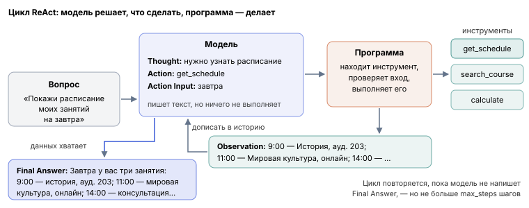

## Зачем это нужно

На лекции был пример. Просим языковую модель: «Покажи расписание моих занятий на завтра». Модель понимает просьбу, но отвечает: «Извините, у меня нет доступа к вашему расписанию». Она не знает, где хранится расписание, и ничего не умеет делать — только писать текст.

**Агент** на ту же просьбу:

1. понимает, что нужны актуальные данные;
2. выбирает подходящий инструмент — например, доступ к календарю;
3. вызывает его;
4. формирует ответ по полученным данным: «Завтра у вас три занятия…».

В уроке 10.6 модель уже просила программу вызвать функцию — один раз. Агент делает это в цикле: столько шагов, сколько нужно, и сам решает, когда задача решена.

## Что такое агент

OpenAI называет агентами системы, которые самостоятельно выполняют задачи от имени пользователя. Модель управляет ходом работы и сама выбирает инструменты. Она понимает, когда задача решена, а при неудаче останавливается и возвращает управление человеку. У агента три компонента (слайд 18):

- **модель** — рассуждает и решает, что делать дальше;
- **инструменты** — функции и API, через которые агент получает данные и действует во внешнем мире;
- **инструкции** — что делать, в каком формате и чего делать нельзя.

Связывает их **цикл рассуждений**: модель предлагает шаг, программа выполняет его и показывает результат, модель предлагает следующий. Самая известная схема такого цикла — **ReAct** (Reasoning and Acting, 2022).

## Инструменты — обычные функции

Инструменты нашего агента: расписание из примера лекции, поиск по урокам курса из урока 11.3 и калькулятор.

```python
SCHEDULE = {'сегодня': ['16:00 — Анализ данных, ауд. 301'],
            'завтра': ['9:00 — История, ауд. 203', '11:00 — Мировая культура, онлайн',
                       '14:00 — Консультация с группой Б-21, ауд. 105']}

def get_schedule(day):
    day = day.strip().lower()
    if day not in SCHEDULE:
        return f'Нет расписания на «{day}». Есть: {", ".join(SCHEDULE)}.'
    return '; '.join(SCHEDULE[day])

def search_course(query):
    scores = (X @ vectorizer.transform([query]).T).toarray().ravel()
    i = int(np.argmax(scores))
    return f"[{docs[i]['lesson']}] {docs[i]['section']}: {docs[i]['text'][:200]}"

OPS = {ast.Add: operator.add, ast.Sub: operator.sub, ast.Mult: operator.mul, ast.Div: operator.truediv,
       ast.USub: operator.neg}

def calculate(expression):
    def ev(node):
        if isinstance(node, ast.Constant) and type(node.value) in (int, float):
            return node.value
        if isinstance(node, ast.BinOp) and type(node.op) in OPS:
            return OPS[type(node.op)](ev(node.left), ev(node.right))
        if isinstance(node, ast.UnaryOp) and type(node.op) in OPS:
            return OPS[type(node.op)](ev(node.operand))
        raise ValueError('допустимы только числа, + - * / и скобки')
    try:
        return str(ev(ast.parse(expression, mode='eval').body))
    except (SyntaxError, ValueError, ZeroDivisionError) as e:
        return f'Ошибка: {e}'

TOOLS = {
    'get_schedule': {'func': get_schedule, 'description': 'расписание занятий пользователя; вход — день: «сегодня» или «завтра»'},
    'search_course': {'func': search_course, 'description': 'поиск по урокам курса; вход — вопрос или ключевые слова'},
    'calculate': {'func': calculate, 'description': 'калькулятор; вход — выражение из чисел, + - * / и скобок'},
}
print(get_schedule('завтра'))
print(calculate('3 * 90'), '|', calculate('9**9**9'), '|', calculate("__import__('os')"))
print(search_course('кросс-валидация')[:90], '…')
```

Каждый инструмент принимает строку и возвращает строку: так их удобно вписывать в текст для модели. Ошибки инструменты не выбрасывают, а возвращают текстом — модель прочитает его и поправится. Калькулятор разбирает выражение через `ast` и пропускает только числа и четыре действия. Поэтому `9**9**9`, который подвесил бы калькулятор из урока 10.6, и попытка выполнить код получают отказ.

Реестр `TOOLS` хранит рядом с функцией её описание — то, что увидит модель.

## Инструкция: формат ReAct

Модель узнаёт об инструментах только из промпта. Инструкцию собираем из реестра — добавили инструмент, и он сам появился в списке:

```python
def react_prompt(tools):
    lines = '\n'.join(f'- {name}: {t["description"]}' for name, t in tools.items())
    return ('Ответь на вопрос пользователя. Тебе доступны инструменты:\n' + lines + '\n\n'
            'Пиши строго в формате:\n'
            'Thought: что нужно сделать\n'
            f'Action: одно из {list(tools)}\n'
            'Action Input: вход инструмента\n'
            'Observation: результат (его допишет программа)\n'
            '… Thought, Action, Action Input и Observation повторяются сколько нужно …\n'
            'Final Answer: ответ пользователю\n\n')

print(react_prompt(TOOLS))
```



**Thought** — рассуждение модели: что известно и что нужно сделать. **Action** и **Action Input** — какой инструмент вызвать и с каким входом. **Observation** — результат инструмента; его пишет не модель, а программа. **Final Answer** — ответ пользователю, конец цикла.

## Цикл агента

Программа разбирает ответ модели регулярными выражениями, как в уроке 10.5:

```python
def parse_step(reply):
    reply = reply.split('Observation:')[0]               # результат пишет программа, а не модель
    final = re.search(r'Final Answer:\s*(.+)', reply, re.S)
    if final:
        return 'final', final.group(1).strip(), None
    action = re.search(r'Action:\s*(\w+)\s*\nAction Input:\s*(.+)', reply)
    if action:
        return 'action', action.group(1), action.group(2).strip()
    return 'error', None, None

def run_agent(question, model, tools, max_steps=5):
    history = react_prompt(tools) + f'Question: {question}\n'
    for step in range(max_steps):
        reply = model.invoke(history).content
        kind, a, b = parse_step(reply)
        history += reply.split('Observation:')[0].rstrip() + '\n'
        if kind == 'final':
            return a, history
        if kind == 'action' and a in tools:
            observation = tools[a]['func'](b)
        elif kind == 'action':
            observation = f'Ошибка: инструмента {a} нет. Есть: {", ".join(tools)}.'
        else:
            observation = 'Ошибка формата: нужны строки Action и Action Input или Final Answer.'
        history += f'Observation: {observation}\n'
    return 'Не удалось ответить за отведённое число шагов.', history
```

На каждом шаге модель получает всю историю: инструкцию, вопрос, свои прошлые шаги и их результаты. Помнить что-то между вызовами она не умеет (урок 10.3). Цикл ограничен `max_steps`: модель может ходить по кругу, а каждый шаг — это запрос и деньги.

## Агент за работой

Настоящему GigaChat нужен ключ, поэтому отвечает тестовая модель с заготовленными шагами. Логика программы при этом настоящая: инструменты выполняются, результаты попадают в историю.

```python
model = FakeListChatModel(responses=[
    'Thought: Нужно узнать расписание на завтра.\nAction: get_schedule\nAction Input: завтра',
    'Thought: Расписание есть, можно отвечать.\nFinal Answer: Завтра у вас три занятия: в 9:00 история '
    '(ауд. 203), в 11:00 мировая культура (онлайн) и в 14:00 консультация с группой Б-21 (ауд. 105).',
])
answer, history = run_agent('Покажи расписание моих занятий на завтра', model, TOOLS)
print(history[history.index('Question:'):])
print('Вызовов модели:', len(model.calls))
```

Два вызова модели: на первом она попросила инструмент, на втором ответила. `Observation` между ними дописала программа — это настоящий результат `get_schedule`.

## Когда что-то идёт не так

Настоящие модели ошибаются. Покажем две частые ошибки на заготовленных ответах:

```python
model = FakeListChatModel(responses=[
    'Thought: Узнаю, сколько занятий завтра.\nAction: get_schedule\nAction Input: завтра\nObservation: два занятия',
    'Thought: Три занятия по 90 минут.\nAction: calculator\nAction Input: 3 * 90',
    'Thought: Инструмент называется calculate.\nAction: calculate\nAction Input: 3 * 90',
    'Thought: Теперь я знаю ответ.\nFinal Answer: Завтра у вас 270 минут занятий — три пары по 90 минут.',
])
answer, history = run_agent('Сколько минут займут мои занятия завтра, если каждое идёт 90 минут?', model, TOOLS)
print(history[history.index('Question:'):])
```

На первом шаге модель сама дописала `Observation: два занятия` — выдумала результат инструмента, не дождавшись его. Программа отрезала всё после `Observation:` и вписала настоящий результат: три занятия. Настоящие агенты делают то же иначе — передают модели **стоп-последовательность** `Observation:`, и модель прекращает писать, дойдя до неё.

На втором шаге модель перепутала имя инструмента: `calculator` вместо `calculate`. Программа не упала, а вернула ошибку текстом со списком доступных инструментов, и модель поправилась на следующем шаге.

## Типичные ошибки

:::mistake Верить Observation от модели
Модель продолжает текст и легко допишет результат инструмента сама — правдоподобный и выдуманный. Observation пишет только программа, а всё, что модель написала после `Observation:`, отбрасывается.
:::

:::mistake Цикл без предела шагов
Модель может вызывать один инструмент снова и снова или не прийти к Final Answer. Без `max_steps` агент будет тратить запросы бесконечно. Предел и честное сообщение «не удалось» — обязательная часть цикла.
:::

:::mistake Падать на ошибке модели
Неизвестный инструмент, сломанный формат, исключение внутри функции — всё это обычные события в работе агента. Программа возвращает ошибку модели текстом в Observation: модель её прочитает и попробует иначе.
:::

## Мини-квиз

```quiz
- q: Кто выполняет инструмент в цикле ReAct?
  options:
    - Программа — модель только пишет Action и Action Input
    - Модель сама вызывает функцию
    - Пользователь
  answer: 0
  explain: Модель пишет текст. Программа разбирает его, выполняет инструмент и дописывает Observation.
- q: Модель в ответе написала строку Observation сама. Что делает программа?
  options:
    - Отбрасывает её и вписывает настоящий результат инструмента
    - Принимает как результат инструмента
    - Останавливает агента с ошибкой
  answer: 0
  explain: Это выдуманный результат. Observation пишет только программа; настоящие агенты ещё и останавливают генерацию стоп-последовательностью.
- q: Зачем циклу агента max_steps?
  options:
    - Модель может ходить по кругу, а каждый шаг — запрос и деньги
    - Чтобы модель отвечала быстрее
    - Без него не работает Final Answer
  answer: 0
  explain: Предел шагов защищает от бесконечного цикла; если он исчерпан, агент честно сообщает, что не справился.
```

## Что запомнить

- Агент — модель, инструменты и инструкции, связанные циклом: модель решает, программа делает.
- ReAct: Thought → Action → Action Input → Observation, и так до Final Answer.
- Инструменты — обычные функции; модель знает о них только из описаний в промпте.
- Observation пишет программа, а не модель; ошибки инструментов возвращаются модели текстом.
- Цикл ограничен числом шагов: модель может зациклиться.
