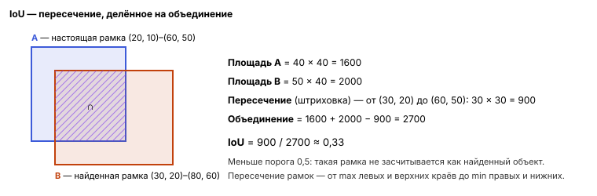

## Зачем это нужно

В лекции (слайды 5–9) три задачи зрения стоят рядом:

- **классификация** отвечает «что на картинке» одним классом — как CLIP в уроке 9.7;
- **обнаружение объектов** находит каждый объект и обводит рамкой: беспилотному автомобилю мало знать, что на дороге «есть пешеход», нужно знать, где именно;
- **сегментация** размечает каждый пиксель: какие пиксели — дорога, какие — тротуар, где опухоль на снимке.

Модель для таких задач строит нейросеть, но меряют её качество одинаково, какой бы она ни была. Совпадение рамок — **IoU**, качество детектора — **точность** и **полнота**, качество сегментации — IoU масок. Разберём их на сцене, где правильные ответы известны точно, — её нарисовала программа.

## Сцена и настоящие рамки

```python
def show(img, boxes, color='lime', title=''):
    fig, ax = plt.subplots(figsize=(5, 3.4))
    ax.imshow(img)
    for x1, y1, x2, y2 in boxes:
        ax.add_patch(plt.Rectangle((x1 - 0.5, y1 - 0.5), x2 - x1, y2 - y1, fill=False, color=color, lw=2))
    ax.set_title(title)
    ax.axis('off')
    plt.show()

show(scene, true_boxes, title='Сцена и настоящие рамки красных объектов')
print('рамки (x1, y1, x2, y2):', true_boxes)
```

Ищем красные объекты. Рамка — четыре числа: левый и верхний край, правый и нижний. Правый и нижний край в рамку не входят, как в срезах Python. Второй объект частично закрыт синим кругом. Тёмно-красное пятно справа вверху — не объект, но похоже по цвету.

## Простейший детектор: пятна маски

Возьмём маску «много красного» из урока 12.1. Связные пятна маски — группы соседних пикселей — получат номера, и у каждого пятна найдётся рамка:

```python
r, g, b = (scene[:, :, k].astype(int) for k in range(3))
red = (r > 150) & (g < 100) & (b < 100)
labels, n = ndimage.label(red)                       # связные пятна → номера 1, 2, …
candidates = []
for k, sl in enumerate(ndimage.find_objects(labels), start=1):
    box = (sl[1].start, sl[0].start, sl[1].stop, sl[0].stop)
    area = int((labels[sl] == k).sum())
    candidates.append((box, area))
    print(f'пятно {k}: рамка {box}, площадь {area}')
found = [box for box, area in candidates if area >= 100]
print('после фильтра по площади:', found)
```

Пятен четыре. Два — наши объекты. Третье — тёмно-красное пятно-обманка. Четвёртое — уголок второго объекта площадью 6 пикселей: синий круг отрезал его от остального прямоугольника. Фильтр «не меньше 100 пикселей» убрал мелочь. Но правило работает только здесь: на настоящих фотографиях то же правило в уроке 12.1 сработало на рамене, пицце и платье фламенко.

## IoU: насколько совпали рамки

Найденная рамка почти никогда не совпадает с настоящей до пикселя. Насколько они совпали, меряют **IoU** (intersection over union) — площадью пересечения, делённой на площадь объединения:



```python
def box_iou(a, b):
    ix = max(0, min(a[2], b[2]) - max(a[0], b[0]))       # ширина пересечения
    iy = max(0, min(a[3], b[3]) - max(a[1], b[1]))       # высота пересечения
    inter = ix * iy
    area = lambda bx: (bx[2] - bx[0]) * (bx[3] - bx[1])
    return inter / (area(a) + area(b) - inter)

print('пример со схемы:', round(box_iou((20, 10, 60, 50), (30, 20, 80, 60)), 3))
# ответ обученного детектора — рамки с уверенностью (их мы написали сами, для примера)
detections = [((14, 12, 41, 36), 0.94), ((12, 9, 39, 33), 0.81), ((72, 47, 108, 71), 0.88),
              ((74, 14, 84, 23), 0.55), ((40, 60, 52, 72), 0.20)]
for box, score in detections:
    best = max(box_iou(box, t) for t in true_boxes)
    print(f'{box} уверенность {score:.2f} → лучший IoU с настоящей рамкой {best:.2f}')
```

Обычно рамка считается найденным объектом, если IoU с настоящей не меньше 0,5. У первой, самой уверенной рамки IoU 0,76 — объект найден. Вторая рамка с тем же объектом — **повтор**: детекторы часто выдают несколько рамок на один объект. Рамка у тёмного пятна не совпадает ни с одной настоящей — это **ложная тревога**.

## Точность, полнота и подавление повторов

Сравним рамки с настоящими: каждая настоящая рамка может «поймать» только одну найденную, самую уверенную.

- **Точность** (precision) — доля верных среди найденных: сколько тревог не ложные.
- **Полнота** (recall) — доля найденных среди настоящих: сколько объектов не пропущено.

```python
def evaluate(dets, truths, thr=0.5):
    used, tp = set(), 0
    for box, score in sorted(dets, key=lambda d: -d[1]):          # от самой уверенной
        ious = [(box_iou(box, t), i) for i, t in enumerate(truths) if i not in used]
        best = max(ious, default=(0, None))
        if best[0] >= thr:
            used.add(best[1])
            tp += 1
    return tp / len(dets), tp / len(truths)

confident = [d for d in detections if d[1] >= 0.5]                 # порог уверенности
print('точность и полнота:', evaluate(confident, true_boxes))

def nms(dets, thr=0.5):
    kept = []
    for box, score in sorted(dets, key=lambda d: -d[1]):
        if all(box_iou(box, k) < thr for k, s in kept):
            kept.append((box, score))
    return kept

print('после подавления повторов:', evaluate(nms(confident), true_boxes))
```

Повтор считается ложной тревогой: объект уже найден более уверенной рамкой. **Подавление немаксимумов** (NMS) оставляет самую уверенную рамку и убирает те, что сильно с ней пересекаются. После NMS точность выросла, полнота осталась прежней. Порог уверенности работает как ручка: выше порог — меньше ложных тревог, но больше пропусков.

## Сегментация: маски и обманчивая доля

Сегментация размечает каждый пиксель. Сравним маску «много красного» с настоящей маской объектов:

```python
def mask_iou(pred, true):
    return (pred & true).sum() / (pred | true).sum()

empty = np.zeros_like(true_mask)                      # «объектов нет нигде»
print(f'маска по цвету: доля верных пикселей {(red == true_mask).mean():.3f}, IoU {mask_iou(red, true_mask):.3f}')
print(f'пустая маска:   доля верных пикселей {(empty == true_mask).mean():.3f}, IoU {mask_iou(empty, true_mask):.3f}')
```

Пустая маска верна на 85 % пикселей и при этом не нашла ничего: объекты занимают 15 % картинки, и фон «помогает». Поэтому сегментацию оценивают IoU масок — как рамки, только по пикселям. У маски по цвету IoU 0,97: её портят пятно-обманка и шумные края.

## Генерация: картинка из шума

Генератор картинок по тексту (на слайде 9 — картинка нейросети Kandinsky от Сбера) устроен как **диффузионная модель**. Её обучение начинается с порчи картинок шумом:

```python
with np.load('zs_thumbs.npz') as data:
    stop = data['images'][[str(x) for x in data['ids']].index('778.jpg')]
x0 = stop / 127.5 - 1                                 # пиксели в диапазоне −1…1
eps = np.random.default_rng(0).normal(size=x0.shape)  # шум
fig, ax = plt.subplots(1, 5, figsize=(10, 2.6))
for a, t in zip(ax, [0, 0.3, 0.6, 0.9, 1.0]):
    xt = np.sqrt(1 - t) * x0 + np.sqrt(t) * eps       # чем больше t, тем больше шума
    a.imshow(np.clip((xt + 1) / 2, 0, 1))
    a.set_title(f't = {t}\nсвязь с исходной {np.corrcoef(xt.ravel(), x0.ravel())[0, 1]:.2f}', fontsize=9)
    a.axis('off')
plt.show()
xt = np.sqrt(1 - 0.6) * x0 + np.sqrt(0.6) * eps
print('если знать шум, картинка восстанавливается точно:', np.allclose((xt - np.sqrt(0.6) * eps) / np.sqrt(1 - 0.6), x0))
```

На шаге `t` картинка — смесь исходной и шума: при t = 0 — сама картинка, при t = 1 — чистый шум. Если знать, какой шум добавлен, картинку восстанавливают точно, как в последней строке. Нейросеть учат именно этому: по зашумлённой картинке (и тексту-подсказке) **угадать шум**. При генерации начинают с чистого шума и много раз вычитают предсказанный шум понемногу. Из шума проступает картинка, подходящая к подсказке. Та же техника делает и видео (слайд 10), и реалистичные подделки, поэтому сгенерированное стоит помечать.

## Типичные ошибки

:::mistake Оценивать сегментацию долей верных пикселей
Если объект занимает 5 % картинки, маска «ничего нет» верна на 95 %. Доля верных пикселей почти всегда высокая и мало что говорит. Сравнивайте маски по IoU.
:::

:::mistake Считать каждую рамку детектора находкой
Две рамки на один объект — это одна находка и одна ложная тревога. При подсчёте каждая настоящая рамка «ловит» только одну найденную, а повторы убирают подавлением немаксимумов.
:::

:::mistake Сравнивать детекторы при разных порогах
Точность и полнота зависят от порога уверенности: поднимите порог — точность вырастет, полнота упадёт. Детекторы сравнивают при одинаковых порогах IoU и уверенности или по кривой «точность — полнота».
:::

## Мини-квиз

```quiz
- q: Чем обнаружение объектов отличается от классификации?
  options:
    - Детектор находит каждый объект и указывает рамку, а классификатор даёт один класс на картинку
    - Ничем, это синонимы
    - Детектор работает только с видео
  answer: 0
  explain: Классификатор отвечает «что на картинке», детектор — «где каждый объект и какой он».
- q: Рамки совпали с IoU = 0,3. Засчитывается ли находка при обычном пороге?
  options:
    - Нет, порог обычно 0,5
    - Да, любое пересечение засчитывается
    - Да, если уверенность больше 0,3
  answer: 0
  explain: Рамка считается найденным объектом при IoU ≥ 0,5 с настоящей.
- q: Что предсказывает сеть диффузионной модели при обучении?
  options:
    - Шум, который добавили к картинке
    - Класс картинки
    - Рамки объектов
  answer: 0
  explain: Зная предсказанный шум, его вычитают шаг за шагом — так из шума получается картинка.
```

## Что запомнить

- Классификация — что на картинке; обнаружение — рамки каждого объекта; сегментация — класс каждого пикселя.
- IoU = площадь пересечения / площадь объединения; рамка найдена при IoU ≥ 0,5.
- Точность — доля верных среди найденных рамок, полнота — доля найденных среди настоящих; повторы убирают подавлением немаксимумов.
- Сегментацию оценивают IoU масок: доля верных пикселей завышена фоном.
- Диффузионная модель учится угадывать добавленный шум, а генерирует, шаг за шагом убирая шум из случайной картинки.
